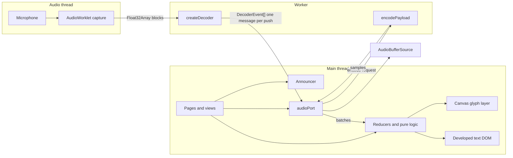

# Design: Ghost Tape UI (screens, darkroom, composer, Side B)

Implements `requirements.md` and `docs/ghost-tape-ui-brief.md`. Section numbers in brackets, e.g. [R4.5], point to acceptance criteria. The modem is consumed exactly as it exists in `src/modem/` (types.ts, index.ts, decoder.ts, modulate.ts, frame.ts, interleave.ts, profiles.ts, tape.ts, accumulator.ts) and `src/audio/wav.ts`; nothing under `src/modem/` changes [R37.7].

Facts in this document come from reading that code or from running it in Node (see *Computed facts*). Sizes of code that does not exist yet (bundle chunks, fonts) are **estimates** and say so. They are replaced by measured values when the bundle check exists.

## Spec issues found in design

Requirements that could not work as written, or that conflicted. The revised `requirements.md` now covers each one; the Status column names the requirement. This document does not change `requirements.md`.

| # | Where | Issue | Evidence | What the design does | Status |
|---|---|---|---|---|---|
| I1 | R14.7 vs R13.7, R15.10 | R14.7 says a non-tape payload gets no "Save as image". R13.7 offers "Save as image" for a developed ghost and R15.10 defines the ghost print. | Direct contradiction in the text. | Ghost: "Save as image" and "Start over"; no "Reply with a tape"; no track buttons. R14.7 is read as covering only Reply and track search. | Resolved: R14.7 now offers "Save as image" for a ghost and withholds only Reply and track buttons |
| I2 | R22.5 | The 2000-character link cap cannot be reached with real payloads. Largest payload is 1024 B (Standard cap), which is 1366 base64url characters; with a 35-character prefix the link is 1401 characters. The cap only triggers when the origin is longer than about 630 characters. | Arithmetic in *Computed facts*. | The check is built as specified and tested with an injected long prefix. It never fires in production. | Accepted: 2000-char cap stays as a safety limit; largest real link is about 1401 characters |
| I3 | R28.3 | "No audible gap longer than 1 s" between passes. `encodePayload` loops with exactly 1 s of digital silence, and each pass starts and ends with a 20 ms tapered chirp, so the audible gap is about 1.04 s. | `LOOP_GAP_SECONDS = 1`, `CHIRP_TAPER_MS = 20` in modulate.ts. | Gap between buffers is exactly 1.000 s of silence, scheduled on the audio clock. R28.3 is read as "no more than 1 s of silence plus the taper". | Resolved: R28.3 now allows a gap of at most 1.1 s (1 s of silence plus chirp tapers); pending developer sign-off |
| I4 | R7.1 vs R32.2 | R7.1 draws provisional glyphs down to opacity 0.1, which is far below 4.5:1 text contrast. R32.2 asks for text contrast "in every Darkroom state". | 0.1 opacity ink on paper is about 1.2:1. | The Glyph layer is treated as decorative imagery (aria-hidden, R11.1). Every piece of information carried as text (status, pass, clarity, labels, final text) meets the ratios. | Resolved: R7.10, R32.2 and R36.10 now exempt provisional Glyphs below confidence 1 and apply the ratios to a Glyph at confidence 1; signed off by developer |
| I5 | R19.3 vs R19.15 | A newline typed in title, from, to or a track matches both: R19.3 (character outside the charset, since newline is allowed "in the letter only") and R19.15 (line breaks only allowed in the letter). | tape.ts `encodeText` rejects newline outside the letter with its own reason. | R19.15 wins. R19.3 excludes U+000A in non-letter fields. One message per field. | Resolved: R19.3 now excludes a newline outside the letter and defers to R19.15 |
| I6 | Prerequisites table, R37.4 | `decoder.ts` emits `progress` (`maybeProgress`, every 200 ms of payload time) and acoustic-modem task 13 is checked. Only task 15 (browser adapters) is still open: `src/audio/` holds only `wav.ts`. | decoder.ts lines for `maybeProgress`; tasks.md. | Replay feeds are recorded from the real decoder through `channel.ts` from the start. The synthesized feed is only a unit-test fixture for exact event sequences. The `AudioPort` fake stays for tests. The adapters are specified as a port (see *Audio port and assumed task-15 adapters*). | Resolved: the revised introduction and R37.3, R37.4 state that `progress` is emitted; only task 15 remains a prerequisite |
| I7 | R9.1, R33.2 | R9.1 relies on `pass-complete` and `complete` arriving in one batch. That holds in `decoder.ts` (`finishPass` pushes both inside one `push`), but only if the task-15 worker posts one message per `push()`. | decoder.ts `finishPass`. | The reducer processes whole batches and also keeps a 120 ms grace before showing "still faint", so an adapter that splits a batch still behaves. | Handled by the 120 ms grace timer (R9.1); task 15 should still keep batches |
| I8 | R12.4 | Feeding a file in chunks "of at most 1 second" is fine for responsiveness, but at roughly 100x real time a 14 s demo file would develop in 0.15 s, which removes the ritual (principle 1) without breaking any criterion. | Decoder speed in the acoustic-modem design (about 117x real time offline). | File feeds are paced by the audio clock (decision D9). The demo-file path plays the audio while feeding. | Resolved: R12.4 paces the feed by the audio clock, R12.10 adds "Skip", R1.7 plays the demo file aloud; D9 approved |
| I9 | R24.3 | "Self-contained module under 6 KB gzipped" does not say whether code shared with the modem counts. | — | The QR generator reuses `rsEncode` from `src/modem/reedSolomon.ts` (same field and generator roots as QR, documented in that file). The check script reports the QR chunk size with and without it; the budget applies to the own-code figure and the design aims to keep both under 6 KB. | Resolved: R24.3 counts the QR generator's own code, excludes modem modules already in the bundle, and requires the figure reported both ways |
| I10 | R14.1 vs R8.2 | R14.1 wants the Developed text in the DOM within 500 ms of `complete`. R8.2 says the Glyph layer is replaced by Developed text when the Fixing moment ends, up to 1.5 s later. | Both are in the text. | The Developed text is written to the DOM at `complete`, visually hidden but present for assistive technology, and revealed by a cross-fade at the end of the Fixing moment. Both criteria hold. | Resolved: R8.2 and R14.1 now describe hidden-then-revealed Developed text |
| I11 | R13.1 | "Single line" for a ghost of up to 138 characters cannot be one physical line on a 360 px screen. | 138 cells at 8 px minimum is 1104 px. | Read as one paragraph with no J-card, wrapped to the screen. | Resolved: R13.1 now reads "a single paragraph of text (wrapping allowed)" |

## Design decisions

| # | Question | Decision | Why |
|---|---|---|---|
| D1 | Routing on Cloudflare Pages: hash or History API | **History API** with paths `/`, `/receive`, `/compose`, `/play`, `/broadcast`. | The URL fragment is reserved for the tape payload [R22.4]. Pages serves the root for any path that is not a static asset when the project has no `404.html` ([Cloudflare Pages: Serving Pages](https://developers.cloudflare.com/pages/configuration/serving-pages/)), so no `_redirects` is needed and fragments never reach a server. |
| D2 | Where `encodePayload` runs | In the modem Worker (message `encode`), result transferred back. | A 66.4 s Standard tape took 99 ms to encode in Node here (about 0.4 s on a 4x slower CPU). That is fine for the UI thread, but R23.5 needs a 10 s timeout that a synchronous call cannot enforce. Same worker file as the decoder, so no extra bundle. |
| D3 | Duration shown in the Composer | Computed in closed form from `geometry`, `payloadSymbolCount` and `frameLayout`, not by encoding. | Verified equal to `encodePayload`'s `durationSec` in all 32 sampled cases (worst difference 0 s). No audio rendered per keystroke [R20.4]. |
| D4 | Test DOM | jsdom, only in files marked `// @vitest-environment jsdom`. All logic is pure and tested in Node. | axe-core is tested against jsdom. happy-dom has less complete accessibility semantics. Playwright would add a browser download and schedule risk in week 3. |
| D5 | QR reference decoder | `jsqr` (Apache-2.0, 1.4.0), dev dependency only. | Pure JS, takes RGBA bytes, runs in Node with no DOM. A known-answer set alone would only check strings I produced myself. |
| D6 | Service worker | Hand-written (about 80 lines), generated into `dist/sw.js` by a small Vite plugin. No Workbox. | Workbox is large and its runtime caching is more than a cache-first static app needs. |
| D7 | Fonts | EB Garamond (SIL OFL), Regular and Italic, subset woff2 committed. | See *Design tokens*. |
| D8 | Link versus audio carrier for REC | REC encodes once with the `link` Carrier's profile. "Download audio" re-encodes only if the `file` profile differs from the one already rendered. | R21.1 says one encode per REC press; later carriers may map to other profiles. |
| D9 | File feeding pace | Every file (demo and upload): 1x real time by the audio clock. The demo file plays aloud while it decodes [R1.7]. A "Skip" control feeds the rest at full speed in the same chunks [R12.10]. Tests pass `Infinity`. | Pacing the input is not faking: every event still comes from the decoder, and Skip changes timing only. It keeps the ritual and the demo fallback visually equal to the live path. Confirmed by developer: Skip on the demo file also stops the speaker. |
| D10 | Mode hint in the Receive URL | **Not used.** `?mode=line` is omitted. | Kind is known from position 0, which is transmitted first (see *Kind detection*). A shorter URL keeps the QR at version 3 or 4. |
| D11 | Demo audio file | Generated at `predev`, `prebuild` and `pretest` into `src/ui/assets/ghost-tape-demo.wav` (gitignored), imported with `?url` so Vite hashes it. | Never stale in normal use; the stale test [R2.7] still catches bypasses. Hashed name makes it cacheable forever. |
| D12 | Carrier of the demo | `demo` -> `standard`, 13.9 s at both rates. | [R27.3] and *Computed facts*. |

## Overview

Ghost Tape UI is a static, framework-free TypeScript application. It has three kinds of code:

1. **Pure logic** in `src/ui/` (no DOM, injectable clock, no randomness). The darkroom state machine, the layout hint parser, the glyph model, validation, character conversion, link fragments, the QR encoder, print pagination, the carrier table and the pass clock. These are property-tested in Node.
2. **DOM views** in `src/ui/` (canvas glyph layer, developed text, J-card component, composer, pages). They render pure state and are tested with jsdom examples and an axe scan.
3. **Browser adapters** in `src/audio/` (microphone, AudioWorklet, Worker, playback, wake lock). The UI talks to them only through one port interface (`src/ui/audioPort.ts`) so tests use a fake.



Two worlds share one type system. The **darkroom** (receive: dark ground, red safelight, a sheet of photographic paper) and the **cassette world** (compose and send: J-card, spinning cassette, REC key) use the same typeface, type scale, spacing and motion tokens and differ only in palette [R36.3].

The truthfulness rule is structural. The darkroom reducer accepts only `DecoderEvent` batches, user actions and clock ticks. It has no other input, so no animation can start from anything but a real event [R4.10]. Provisional bytes live in a type (`ProvisionalByte`) that the Developed text builder does not accept [R11.3].

### Values fixed in design

Values the requirements left to design, with the reason for each.

| Constant | Value | Used by | Justification |
|---|---|---|---|
| `KIND_CONFIDENCE_MIN` | 0.6 | [R5.2] | Confidence is `1 - second/best` of the summed tone shares, so 0.6 means the winning tone has at least 2.5 times the runner-up's share. A wrong kind byte only costs a wrong layout; the exact-sum rule protects the J-card hint separately. |
| `LAYOUT_CONFIDENCE_MIN` | 0.6 | [R6.6] | Same reasoning. A wrong prefix byte almost never gives lengths that sum exactly to `payloadLength` (see layout hint). |
| `GLYPH_OPACITY_MIN` | 0.1 | [R7.1] | Given. |
| `GLYPH_BLUR_MAX_EM` | 0.30 em at confidence 0 | [R7.1] | At 16 px type that is 4.8 px of blur: letters are unreadable, shapes still visible. |
| `FLICKER_BELOW` | 0.75 | [R7.4] | Settles a glyph once the winner has four times the runner-up's share. Tunable on the Test phone. |
| `FLICKER_PERIOD_MS` | 250 (4 character changes per second per position) | [R7.4] | Slow enough to read as grain, not strobe. Each position has its own phase offset, so there is no frame where all positions change. Characters change, luminance does not. |
| `HISTORY_DEPTH` | 8 distinct values per position | [R7.7] | Bounds memory at about 10 KB per tape. Oldest value is replaced first. |
| `SAFELIGHT_FLICKER_MS` | 240 | [R4.2] | Inside 150 to 400 ms. |
| `FIX_TOTAL_MS` | 1300 | [R8.4] | Under 1.5 s with 200 ms spare for a slow frame. |
| `FAINT_GRACE_MS` | 120 | [R9.1] | Copy appears 120 ms after a batch, inside 200 ms. |
| `PROGRESS_COALESCE` | one render per animation frame | [R33.3, R33.4] | See *Coalescing*. |
| `SHEET_CELL_MIN_PX` | 8 | sheet geometry | Smallest readable grain cell on a 360 px screen. |
| `FILE_CHUNK_SEC` | 0.5 | [R12.4] | Worker does the decoding, so the main thread only posts a slice. |
| `ENCODE_TIMEOUT_MS` | 10000 | [R23.5] | Given. |
| `LINK_MAX_CHARS` | 2000 | [R22.5] | Given. |
| `PNG_W`, `PNG_H`, `PNG_MAX_IMAGES` | 1080, 1350, 4 | [R15] | Given. |
| `TAPE_MIN_SEC`, `TAPE_MAX_SEC` | 7.525, 66.4 | cassette scale | Shortest valid Standard tape and the 1024 B Standard maximum, both computed. |

## Architecture

### Layers and threads

| Layer | Code | Knows about | Never touches |
|---|---|---|---|
| Pure logic | `src/ui/**` files marked pure in the module map | `src/modem` types, `tape.ts`, `interleave.ts`, `frame.ts`, `profiles.ts` | DOM, Web Audio, `Date.now`, `Math.random` |
| Views | `src/ui/**` DOM files | Pure logic, `tokens.ts`, `copy.ts` | Audio APIs (only through the port) |
| Adapters | `src/audio/**` | Web Audio, Worker, getUserMedia, Wake Lock | UI state |
| Worker | `src/audio/modemWorker.ts` | `createDecoder`, `encodePayload` | DOM |

Deep imports from the modem (read-only, pure): `tape.ts` (`LIMITS`, `CHARSET_MARKS`, `CHARSET_CHARACTERS`, `serializePayload`, `deserializePayload`, `encodeText`) as R37.7 names; also `interleave.ts` (`geometry`, `payloadSymbolCount`), `frame.ts` (`frameLayout`, `sampleAtMs`), `profiles.ts` (`PROFILES`, `profileByName`, `STANDARD`, `ROBUST`) for the duration formula (D3). R37.7 now permits these read-only deep imports (approved, Q1). The unused fallback would have been a debounced `encodePayload` in the Worker.

### Module map: `src/ui/`

`P` = pure (Node-testable), `D` = DOM. "Chunk" is the Vite chunk it lands in (see *Routing and bundle*).

| Module | Kind | Chunk | Role |
|---|---|---|---|
| `app.ts` | D | main | Boot: shell, router, service worker registration, reduced-motion store |
| `router.ts` | P + D | main | `matchRoute(pathname)` (pure, total), History API wiring, unmount hooks [R30] |
| `routes.ts` | P | main | Route table: path, heading key, loader |
| `shell.ts` | D | main | Navigation (Receive, Compose), `main` landmark, one `h1`, offline-ready chip, update notice |
| `announcer.ts` | P + D | main | Polite live-region queue [R32.4, R32.10] |
| `tokens.css`, `tokens.ts` | — | main | Design tokens, same names in both [R36.1] |
| `copy.ts` | P | main | Every user-visible string [R38] |
| `audioPort.ts` | P (types) + D | main | The only way views reach audio (see below) |
| `darkroom/state.ts` | P | main | `DarkroomState`, `initialDarkroom()` |
| `darkroom/reduce.ts` | P | main | `reduceBatch`, `reduceTick`, `reduceAction` |
| `darkroom/history.ts` | P | main | `SymbolHistory` |
| `darkroom/glyphs.ts` | P | main | Opacity, blur, flicker, `glyphChar` |
| `darkroom/layoutHint.ts` | P | main | `parseLayoutHint`, `layoutFromPayload` |
| `darkroom/sheet.ts` | P | main | Generic, J-card and single-line geometry |
| `darkroom/timeline.ts` | P | main | Safelight, fixing and countdown as functions of (state, now) |
| `darkroom/viewModel.ts` | P | main | `developedView(state)`: what text may exist in the DOM |
| `darkroom/glyphCanvas.ts` | D | main | Canvas renderer with sprite cache and dirty cells |
| `darkroom/darkroomView.ts` | D | main | Tray, safelight, status text, developed text, actions |
| `darkroom/controller.ts` | D | main | Port events -> batch queue -> animation frame -> reducer -> view |
| `pages/home.ts` | D | main | Demo-first landing [R1, R2] |
| `pages/receive.ts` | D | `receive` | Listen and upload [R12] |
| `pages/player.ts` | D | `player` | Tape-player [R23] |
| `pages/compose.ts` | D | `compose` | Composer shell and sending options |
| `pages/broadcast.ts` | D | `broadcast` | Side B [R28, R29] |
| `jcard/jcardLayout.ts` | P | main | Slot geometry shared by Composer and Darkroom [R18.12] |
| `jcard/jcardView.ts` | D | main | The J-card component, two modes: `edit` and `develop` |
| `composer/draft.ts` | P | `compose` | Draft type, `draftToPayload` |
| `composer/convert.ts` | P | `compose` | Character conversion table [R19.5, R19.6] |
| `composer/validate.ts` | P | `compose` | Pre-checks and report [R19] |
| `composer/messages.ts` | P | `compose` | Reason -> `copy.ts` key mapping [R19.10] |
| `composer/duration.ts` | P | `compose` | Closed-form duration [R20] |
| `composer/cassette.ts` | P | `compose` | Tape length function |
| `composer/throttle.ts` | P | `compose` | Leading-edge throttle with trailing call, injectable clock |
| `composer/broadcastSuggest.ts` | P | `compose` | Suggested broadcast message [R26.2] |
| `composer/draftStore.ts` | D | `compose` | `localStorage` with permission [R18.9, R18.13] |
| `composer/composerView.ts` | D | `compose` | Inputs, mirrors, flip, REC key, options |
| `carriers.ts` | P | main | The Carrier profile table [R27] |
| `fragment.ts` | P | `player` and `compose` | Tape link fragment [R22] |
| `receiveUrl.ts` | P | main | `receiveUrl(origin)` |
| `qr.ts` | P | `qr` | QR encoder, versions 1 to 6, level M [R24] |
| `qrView.ts` | D | `qr` | Canvas painter, module size for the viewport |
| `print/layout.ts` | P | `print` | Pagination [R15] |
| `print/render.ts` | D | `print` | Canvas drawing and PNG blob |
| `print/share.ts` | D | `print` | Web Share or download |
| `passClock.ts` | P | `broadcast` | Pass index from the audio clock [R28.6] |
| `fileName.ts` | P | `compose` | WAV and PNG file names [R15.4, R25.3] |
| `dev.ts`, `spectrogram.ts` | D | dev only | Existing dev harness, spectrogram [R37.8] |

### Audio port and assumed task-15 adapters

`src/audio/` contains only `wav.ts` today, and acoustic-modem task 15 is not checked. The UI therefore codes against a **port** and lists the adapter behaviour it assumes. If the real adapters differ, only `src/ui/audioPort.ts` (the real implementation half) changes.

```ts
// src/ui/audioPort.ts (types: pure, implementation: DOM)
export type MicFailure = 'denied' | 'no-microphone' | 'insecure-context' | 'rate-unsupported' | 'failed';

export interface ListenSession {
  readonly sampleRate: number;          // AudioContext.sampleRate actually in use [R3.4]
  stop(): void;                         // stops every mic track [R3.9]
}
export interface PlayHandle {
  readonly startedAtSec: number;        // AudioContext.currentTime when the first sample plays
  stop(): void;
  readonly ended: Promise<void>;
}
export interface FeedSession {          // decode a Float32Array through the worker decoder
  push(samples: Float32Array): void;    // chunks <= FILE_CHUNK_SEC
  finish(): void;                       // calls flush() exactly once [R12.7]
  cancel(): void;
}
export interface AudioPort {
  /** Create or resume the shared AudioContext inside a user gesture. */
  ensureContext(): Promise<Result<{ sampleRate: number }>>;
  listen(onBatch: (events: DecoderEvent[]) => void): Promise<Result<ListenSession> | { ok: false; reason: MicFailure }>;
  openFeed(sampleRate: number, onBatch: (events: DecoderEvent[]) => void): FeedSession;
  decodeFile(file: Blob): Promise<Result<{ samples: Float32Array; sampleRate: number }>>;
  fetchAsset(url: string): Promise<Result<ArrayBuffer>>;
  play(samples: Float32Array, sampleRate: number): PlayHandle;
  encode(payload: Payload, profile: ProfileId, sampleRate: number, timeoutMs: number): Promise<Result<EncodedTrack>>;
  /** Side B: sample-accurate scheduling of one pass at an audio-clock time. */
  schedule(samples: Float32Array, sampleRate: number, atSec: number): { cancel(): void };
  readonly nowSec: number;              // AudioContext.currentTime
  keepAwake(): Promise<{ release(): void }>;
}
```

| Assumed from task 15 | Expected behaviour | Risk if different |
|---|---|---|
| `getUserMedia` with `echoCancellation`, `noiseSuppression`, `autoGainControl` all false | As steering `tech.md` | None |
| AudioWorklet capture, 128-sample quanta batched to about 1024 samples per message, transferable buffers | At most about 50 messages per second | More messages: more main-thread wakeups, no data loss |
| Decoder Worker owns `createDecoder({ sampleRate })`; each `push` or `flush` that returns events posts **one message holding that whole array**; empty results post nothing | Batch boundary = decoder call [I7] | If events of one push are split across messages, "still faint" could show wrongly; the 120 ms grace covers it |
| `decodeAudioData` on a context at a fixed 48000 Hz, channels averaged to mono | [R12.3] | A 96 kHz default context would make the decoder inert (range 16000-48000). The design uses an `OfflineAudioContext(1, 1, 48000)` for file decoding |
| Playback of an `AudioBuffer`, with loop option | `play` here | The UI schedules single passes itself (see Side B), so loop is not needed |
| `encodeWav` | Exists in `src/audio/wav.ts` | None |

Additions to `src/audio/` beyond task 15 (all small):

| File | Purpose |
|---|---|
| `modemWorker.ts` | Also handles `encode` messages (D2). If task 15 already creates a decoder worker file, this is the same file with one more message type |
| `workerClient.ts` | Typed client: `listen`, `openFeed`, `encode`, with timeout and `terminate` |
| `passScheduler.ts` | Schedules single passes on the audio clock for Side B |
| `wakeLock.ts` | `navigator.wakeLock.request('screen')`, re-acquired on `visibilitychange`, no-op when unsupported |
| `audioPortImpl.ts` | Implements `AudioPort` over the files above |

### Other files

| Path | Content |
|---|---|
| `public/manifest.webmanifest` | Name, `start_url` `/`, `scope` `/`, `display` `standalone`, colours from tokens, icons |
| `public/icons/` | `icon-180.png` (apple-touch), `icon-192.png`, `icon-512.png`, `icon-maskable-512.png`, `ghost-tape.svg` source. Authored once by hand and committed |
| `public/_headers` | Headers (see *PWA and deployment*) |
| `scripts/sw-template.js` | Service worker template with `__PRECACHE__` and `__VERSION__` |
| `scripts/vite-sw-plugin.mjs` | Writes `dist/sw.js` after the bundle is written |
| `scripts/make-ui-demo.mjs` | Writes `src/ui/assets/ghost-tape-demo.wav` from `copy.ts` demo text (`npm run demo:ui`) |
| `scripts/check-dist.mjs` | Fails the build on missing worker, worklet, demo audio, `_headers`; checks the precache list is complete [R35.7] |
| `scripts/check-bundle.mjs` | First-load JS budget and QR size [R33.6, R33.8, R24.3] |
| `src/ui/fonts/` | Subset `EBGaramond-Regular.woff2`, `EBGaramond-Italic.woff2`, `OFL.txt`, `README.md` with the subsetting command |
| `tests/support/uiRuns.ts` | `fcUi(numRuns = 100)`: fixed seed, at least 100 runs [R37.2] |

**Updates needed in `.kiro/steering/structure.md`** (not edited here): the `src/ui/` subtree above; `src/audio/` files above; `public/` contents (`manifest.webmanifest`, `_headers`, `icons/`); `src/ui/assets/` and `src/ui/fonts/`; new scripts (`make-ui-demo.mjs`, `check-dist.mjs`, `check-bundle.mjs`, `sw-template.js`, `vite-sw-plugin.mjs`); `tests/properties/ui/`, `tests/unit/ui/`, `tests/support/uiRuns.ts`, `tests/support/replay.ts`; a rule that `.gitignore` also lists `src/ui/assets/*.wav`. The "Tests mirror source names" rule needs the `ui/` subfolder.

`package.json` additions: scripts `demo:ui`, `predev`, `prebuild`, `pretest` (all run `demo:ui`), `check:dist`, `check:bundle`; `build` becomes `typecheck && vite build && check:dist && check:bundle`. Dev dependencies, test only: `jsdom`, `axe-core`, `jsqr`.

## Components and Interfaces

### 1. The darkroom state machine (`src/ui/darkroom/`) [R4 to R11, R13]

#### Phases

| Phase | Meaning | Safelight | Paper |
|---|---|---|---|
| `empty` | Nothing received since start or reset [R4.1] | on | none |
| `receiving` | A `header` arrived and the pass is in progress | on | in tray, Generic sheet, J-card sheet or Single-line |
| `between` | A pass ended without `complete`; waiting for the next | on | unchanged |
| `fixing` | `complete` arrived; timeline running (at most `FIX_TOTAL_MS`) | going out | all glyphs sharpening |
| `developed` | Fixing ended; Developed text is visible | off, warm light | developed print |

A flag `unreadable` marks R8.7: a `complete` whose payload cannot be laid out (practically unreachable, because `complete` carries a strictly deserialized payload). The phase stays where it was, the label "Not yet developed" stays, nothing is fixed.

#### Reducer signature

```ts
type DarkroomInput =
  | { readonly type: 'batch'; readonly events: readonly DecoderEvent[] }   // one push() or flush() result
  | { readonly type: 'tick' }                                               // time passed, nothing else
  | { readonly type: 'reset' };                                              // "Start over", new file

function reduceDarkroom(state: DarkroomState, input: DarkroomInput, nowMs: number): DarkroomState;
function reduceBatches(state: DarkroomState, batches: readonly (readonly DecoderEvent[])[], nowMs: number): DarkroomState;
function nextWakeMs(state: DarkroomState, nowMs: number): number | undefined;  // when a tick is next needed
```

`nowMs` is injected. The reducer never reads a clock, never generates a random number, and returns a new state object. Large arrays are copied once per call (copy on first write), not once per event. All strings in state are keys into `copy.ts`, never English text [R38.2].

#### Transitions

Rows are decoder events. "ignore" means the state is returned unchanged.

| Event | `empty` | `receiving` | `between` | `fixing`, `developed` |
|---|---|---|---|---|
| `signal-detected` | Safelight flicker for `SAFELIGHT_FLICKER_MS`; remember steady state [R4.2, R9.9] | ignore | Same as `empty` | ignore |
| `header` | Create blank Paper sized from `payloadLength` (Generic sheet), take checkpoint, set pass, countdown anchor, phase `receiving`, clear notice [R4.3, R10.1] | Different `tapeId`: replace Paper. Same: keep Paper, re-checkpoint | Same `tapeId`: keep Paper and Glyph state, new checkpoint, pass number from event, phase `receiving` [R4.4, R9.2]. Different `tapeId`: replace Paper | ignore |
| `progress` | ignore [R4.6] | If `tapeId` matches the Paper: write provisional bytes, merge Symbol history, re-run kind detection and layout hint, update countdown anchor from `fractionReceived`. Else ignore | ignore | ignore |
| `pass-complete` | ignore | Phase `between`; set clarity from the event; set parts recovered; arm `pendingFaint` [R10.4, R10.5] | ignore | ignore |
| `complete` | Build Paper from the payload, go to `fixing` | Go to `fixing`; clear `pendingFaint` [R9.1] | Same | ignore, keep display [R8.6] |
| `already-received` | ignore | ignore | ignore | Set notice `alreadyHave` [R9.8] |
| `pass-discarded` | Notice by reason; if it follows a flicker with no `header`, restore the steady safelight [R9.9] | Restore the checkpoint; phase `between`; notice by reason; stop countdown [R9.6, R9.7, R10.9] | Notice by reason | ignore |

| Input | Effect |
|---|---|
| `tick` | End a flicker when its time is up. Move `fixing` to `developed` when `now >= fixStartMs + FIX_TOTAL_MS`. Turn an armed `pendingFaint` into notice `faint` when `now - sinceMs >= FAINT_GRACE_MS` |
| `reset` | `initialDarkroom()`; the controller also calls `decoder.reset()` [R12.9] |

While `fixing` or `developed`, every decoder event except `already-received` is ignored. This is also why a different tape heard after completion cannot disturb the print. The controller stops the microphone at `complete` [R3.9].

Interpretation of R10.1: pass number, countdown and clarity update only while developing. After `complete` the print shows "played N times" [R10.8] and no longer changes.

#### Event batches [R9.1]

The adapter hands the reducer one array per `push()` or `flush()`. In `decoder.ts` `finishPass` pushes `pass-complete` and then, if verification passes, `complete`, so both are in one array. The reducer processes events in order and treats `pass-complete` as "pass ended". It does not decide to show "still faint" inside the loop. Two safeguards:

1. At the end of the batch, `pendingFaint` is armed only if no `complete` for that `tapeId` was seen in the same batch.
2. The notice appears on the first `tick` at least `FAINT_GRACE_MS` (120 ms) later, and a `complete` arriving before then cancels it. This covers an adapter that splits a batch across messages [I7] and still meets R9.1's 200 ms.

The controller calls `nextWakeMs` after every reduce and arms one `setTimeout` for the next tick; it needs no polling when nothing is pending.

#### Coalescing progress per animation frame [R33.3, R33.4]

`progress` carries the **full snapshot** of every provisional byte (`provisionalBytes` returns the whole list, "not a delta" in the modem design). The controller therefore queues batches as they arrive and, once per animation frame, calls `reduceBatches(state, queue, now)` and clears the queue. The reducer applies every event in order, so the Symbol history merges every value from every coalesced event and none is lost; only the intermediate glyph states are never rendered. One state clone covers the whole queue. Cost of one frame: a few hundred provisional bytes, well under 1 ms.

#### Symbol history [R7.7]

```ts
interface SymbolHistory {
  readonly depth: 8;                 // HISTORY_DEPTH
  readonly values: Uint8Array;       // length P * 8; values[p*8 + i], i < count[p]
  readonly count: Uint8Array;        // length P, 0..8
  readonly next: Uint8Array;         // length P, ring index used when count = 8
}
function recordValue(h: SymbolHistory, position: number, byte: number): void;  // dedupe by linear scan of <= 8 entries
```

Memory for P = 1024: 8192 + 1024 + 1024 = about 10 KB per tape. The tray holds one tape, and the checkpoint holds a copy, so about 20 KB in total. The history is keyed by `tapeId` through the Paper (a new Paper starts a new history) and is not cleared at `pass-complete`. When a position already has 8 distinct values the oldest is overwritten. The value currently shown is always in the list, because `recordValue` runs before the Glyph is set. This is what makes the membership property true by construction [R7.6, R7.9].

#### Kind detection [R5]

Position 0 holds the kind byte. The permutation sends transmitted byte `i` to interleaved byte `(a * i) mod L`, so transmitted byte 0 is interleaved byte 0, which is payload position 0. The kind byte is the **first** byte on the air. The first `progress` (after about 200 ms of payload) already contains it once its symbols have evidence.

```ts
function detectKind(bytes: Uint8Array, conf: Float32Array, has: Uint8Array): 'unknown' | 'tape' | 'ghost' | 'invalid';
// has[0] && conf[0] >= KIND_CONFIDENCE_MIN:
//   bytes[0] === 0 -> 'tape'; 1 -> 'ghost'; otherwise 'invalid' (keep Generic sheet, no hint) [R5.7]
```

`header` always gives the Generic sheet [R5.1]. Kind changes apply in the same reduce call, so Single-line mode appears in the frame that processes the `progress` [R5.4, R13.1]. A later confident reading that differs discards the hint and switches layout while keeping all bytes [R5.6]. `complete` chooses the layout from `payload.kind` [R5.8, R13.9].

#### Layout hint parser [R6]

```ts
interface LayoutHint {
  readonly titleLen: number; readonly fromLen: number; readonly toLen: number;
  readonly trackLens: readonly number[]; readonly letterLen: number;
  readonly offsets: {            // payload positions, from the serialized layout in tape.ts
    readonly titleLenPos: 1; readonly title: number; readonly fromLenPos: number; readonly from: number;
    readonly toLenPos: number; readonly to: number; readonly date: number; readonly trackCountPos: number;
    readonly trackLenPos: readonly number[]; readonly tracks: readonly number[];
    readonly letterLenPos: number; readonly letter: number; readonly doodleFlagPos: number;
  };
}
function parseLayoutHint(bytes: Uint8Array, conf: Float32Array, has: Uint8Array, payloadLength: number): LayoutHint | undefined;
```

Serialized tape layout (tape.ts): `kind, [u8 len, title], [u8 len, from], [u8 len, to], date(3), trackCount, ([u8 len, track])*, u16 letterLen, letter, doodleFlag`. Algorithm:

1. `known(i) = i < payloadLength && has[i] === 1 && conf[i] >= LAYOUT_CONFIDENCE_MIN`. Return `undefined` unless `known(0)` and `bytes[0] === 0`, and `payloadLength` is known and at least 12 (the smallest tape).
2. `pos = 1`. For each of title, from, to: if `!known(pos)` return `undefined`; `len = bytes[pos]`; reject if `len` exceeds `LIMITS` (40, 24, 24); record offsets; `pos += 1 + len`.
3. Reject if the three lengths are all 0. `date = pos`; `pos += 3`. Date and field bytes are never read or validated [R6.1].
4. `trackCountPos = pos`; require `known`; `count = bytes[pos]`; reject if `count > 10`; `pos += 1`. For each track: require `known(pos)`, reject `len > 60`, `pos += 1 + len`.
5. `letterLenPos = pos`; require `known(pos)` and `known(pos + 1)`; `letterLen = (bytes[pos] << 8) | bytes[pos + 1]`; reject if over 800; `pos += 2 + letterLen`.
6. The doodle flag must sit at `pos`. Accept only if `pos + 1 === payloadLength`. If `known(pos)` and `bytes[pos] !== 0`, reject.
7. Return the hint.

Any step that touches an unknown byte, or a position at or beyond `payloadLength`, returns `undefined`. The parser reads at most `3 + 10 + 4` prefix bytes, so it is O(trackCount), and it is cheap enough to run on every `progress` event. It never throws: all reads go through `known`. Why the exact-sum rule makes a wrong prefix unlikely to be accepted: a misread length shifts every later offset, and the final position must land exactly on `payloadLength - 1`. With 3 to 13 prefix reads each wrong value would have to cancel the others. The hint draws layout only; it never supplies a character [R6.8].

`layoutFromPayload(payload)` builds the same structure from a verified payload (all confidence 1) for the Fixing moment [R6.7], through `serializePayload` and the same parser. P1 checks that parser and builder agree.

#### Glyph state and model [R7]

```ts
interface Glyphs {
  readonly byte: Uint8Array;        // length P, current provisional byte (valid where has = 1)
  readonly conf: Float32Array;      // length P, 0..1
  readonly has: Uint8Array;         // length P, 1 once a provisional byte exists
}
glyphOpacity(c) = 0.1 + 0.9 * c                           // c clamped to [0, 1]; 0.1 at 0, 1.0 at 1
glyphBlurPx(c, fontPx) = GLYPH_BLUR_MAX_EM * fontPx * (1 - c)^2    // 0 px at c = 1; non-increasing
glyphChar(byte) = ASCII 0x20-0x7E as itself; 0x80-0x86 -> CHARSET_MARKS[byte - 0x80]; 0x0A -> '' (blank cell);
                  anything else -> '·' (U+00B7), the same mark everywhere [R7.2]
```

Flicker [R7.4, R7.5, R7.6, R7.8]:

```ts
function flickerStep(position: number, nowMs: number): number {
  const phase = mix32(position * 0x9e3779b1) % FLICKER_PERIOD_MS;   // per-position offset
  return Math.floor((nowMs + phase) / FLICKER_PERIOD_MS);
}
function displayedByte(g, h, position, nowMs, reducedMotion): number | undefined {
  if (!g.has[position]) return undefined;                            // unexposed grain
  if (reducedMotion || g.conf[position] >= FLICKER_BELOW || h.count[position] < 2) return g.byte[position];
  return h.values[position * 8 + (mix32(position + flickerStep(position, nowMs) * 0x85ebca6b) % h.count[position])];
}
```

`mix32` is a fixed integer hash (xorshift-multiply), so the displayed byte is a pure function of (position, history, `nowMs`). There is no `Math.random` and no seed state. A position with fewer than two distinct values never shows anything but its current byte [R7.5]. A position with no byte yet shows grain with no character [R7.3]. With reduced motion the current byte is shown with its confidence opacity and no flicker [R7.8].

At 4 character changes per second per position and independent phases, the layer never changes all glyphs in one frame, so there is no full-field flash.

#### Fixing moment timeline [R8]

| t from `complete` (ms) | Safelight | Glyphs | Light | DOM |
|---|---|---|---|---|
| 0 | starts dimming | Glyph bytes replaced by the verified bytes (from `serializePayload(payload)`); opacity and blur animate towards sharp | warm light starts at 300 | Developed text written, visually hidden, present for assistive technology; controls enabled; announcement posted [R11.6, R14.1] |
| 0 to 600 | 100% to 0% | All glyphs ease to opacity 1, blur 0 together (single easing, no per-glyph delay) | 300 to 1100: warm white rises | |
| 1100 to 1300 | off | Canvas fades out | complete | Developed text fades in |
| 1300 | off | Canvas removed | warm | `phase = developed` on the next tick |

Total 1300 ms, under 1.5 s [R8.4]. Between 0 and 600 ms each glyph already shows its final character, never a different one [R8.5]. With reduced motion the whole end state applies within one frame (at most 100 ms) [R8.3]. A second `complete` is ignored in `fixing` and `developed` [R8.6]. The tray never shows two things at once because the phase is a single value.

The fixing progress is `fixProgress(state, nowMs) = clamp((nowMs - fixStartMs) / FIX_TOTAL_MS, 0, 1)`, a pure function used by the view each frame.

#### Pass information [R10]

| Display | Source | Rule |
|---|---|---|
| Pass number | `header.pass` | Shown from `header`; unchanged by `pass-discarded` [R10.9] |
| Countdown | `header.estimatedSecondsRemaining`, `progress.fractionReceived` | `remaining(now) = max(0, ceil(anchorRemainingSec - (now - anchorMs) / 1000))`. At `header`: `anchorRemainingSec = estimate`. At `progress`: `anchorRemainingSec = estimate * (1 - fractionReceived)`. Whole seconds, rounded up, never below 0. On `pass-discarded` the anchor is frozen at the displayed value [R10.2, R10.3, R10.9] |
| Clarity | `pass-complete.clarity` only | `pct = round(clarity * 100)`. Labelled "previous pass" from the next `header` until the next `pass-complete` [R10.4, R10.6, R10.7] |
| Parts recovered | `pass-complete` | "`blocksRecovered` of `blocksTotal`" [R10.5] |
| Played N times | `complete.passesUsed` | "once" when 1 [R10.8] |

#### Reduced motion

A store reads `matchMedia('(prefers-reduced-motion: reduce)')` once and on change. Views pass `reducedMotion` into `displayedByte` and the timeline. Effects: no flicker, no Paper slide, Safelight flicker becomes a steady state change, Fixing applies in one frame, spinning Cassette becomes a static cassette with the text states "recording" and "done" [R21.6], ON AIR light is steady [R28.12]. Motion token durations become 0 ms or a cross-fade of at most 200 ms [R36.9]. No element changes opacity, position or colour more than once per second [R32.1].

#### Sheet geometry (`sheet.ts`, `jcard/jcardLayout.ts`) [R4.3, R6.4, R13.1]

All geometry is a pure function of lengths and the container width in CSS pixels, so the canvas needs no DOM measurement.

**Generic sheet.** Paper ratio 4:5 matches the print. A cell is 0.6 em wide by 1.6 times its width high, so rows are about half the columns.

```
cols = min( ceil(sqrt(2 * P)), floor(widthPx / SHEET_CELL_MIN_PX) )
cellW = widthPx / cols;  cellH = 1.6 * cellW;  rows = ceil(P / cols);  heightPx = rows * cellH
```
Examples at 328 px: P = 136 gives 17 columns, 8 rows, cells 19.3 by 30.9 px, sheet 247 px high; P = 1024 gives 41 columns (capped), 25 rows, cells 8 by 12.8 px, sheet 320 px high.

**J-card sheet** (hint accepted or verified payload). Columns `cols = min(40, floor(widthPx / 9))`. Positions flow into slots by the hint's offsets; prefix bytes, track count, date bytes and the doodle flag are not drawn as characters.

| Slot | Scale | Columns | Rows |
|---|---|---|---|
| title | 1.5x | `floor(cols / 1.5)` | `max(1, ceil(titleLen / that))` |
| from, to | 1x | `cols` | 1 each, shown as one "from / to" line pair |
| date | 1x | 10 | 1; cells use grain only. Opacity follows the lowest confidence of its three bytes, so no character is invented |
| track i | 1x | `cols - 3` (3 for the number) | `max(1, ceil(len / (cols - 3)))` |
| letter | 1x | `cols` | `ceil(letterLen / cols)`; a newline byte draws a blank cell |

**Single-line sheet** (kind ghost): positions 2 to P - 1 (position 1 is the length byte), `P - 2` cells, 1.5x scale, wrapped at `floor(cols / 1.5)`. R13.1 defines it as one paragraph of text (wrapping allowed) with no J-card, so it is one flowing block of cells and one `<p>` of Developed text, never a single physical line. It appears in the same reduce call that learns the Kind byte, well inside R13.1's 500 ms. `P < 2` gives one empty cell [R13.2].

**One component for both worlds** [R18.12]. `jcardView.ts` builds the same DOM tree in two modes: `edit` puts real inputs in the slots (Composer); `develop` puts empty slot containers and a single canvas over the sheet (Darkroom). Both use the same classes, tokens and the same `jcardLayout` slot rectangles for ordering. At the Fixing moment the Developed text goes into those same slot containers, so the print is the object the sender wrote. The proportional serif text may wrap differently from the fixed grain cells; slots have `min-height` from the hint and are allowed to grow, so nothing is clipped.

### 2. Rendering, accessibility and announcements [R11, R14, R32]

**Two layers.**

| Layer | Element | Content | Accessibility | Pointer |
|---|---|---|---|---|
| Glyph layer | One `<canvas>` over the Paper | Provisional Glyphs and grain only | `aria-hidden="true"`, zero text nodes, so it adds 0 characters to `textContent` and to the accessibility tree [R11.1] | `pointer-events: none` |
| Developed text | Real DOM text in slot elements | Title, from, to, date, tracks, letter; written only from a `complete` payload [R11.2] | Normal text; letter uses `white-space: pre-wrap` to keep line breaks [R14.1]; title is an `h2` below the route's single `h1` | Selectable |

**Hidden, then revealed [R8.2, R14.1].** At `complete` the Developed text is written into the slots in the same frame that reduces the event (well inside 500 ms) with the `visually-hidden` clip technique, not `display: none` or `visibility: hidden`, so it is in the DOM and the accessibility tree but not visible. It is revealed by a cross-fade when `revealed` becomes true, which is at the end of the Fixing moment (at most `FIX_TOTAL_MS` = 1300 ms after the event; at once with Reduced motion). The Glyph layer is removed at the same moment, so the two never show text together. A `complete` that is ignored (R8.6) never rewrites the text.

Before `complete` the slots contain no text, and a visible status line reads "Not yet developed" [R11.4]. "Save as image" and "Reply with a tape" are `disabled` buttons until `complete` [R11.5]; they are enabled by the render of the same state that contains the payload, so both flip together [R11.8].

`darkroom/viewModel.ts` exposes the single decision point:

```ts
interface DevelopedView { readonly text: Payload | undefined; readonly controlsEnabled: boolean; readonly label: 'not-yet' | 'developed'; readonly revealed: boolean }
function developedView(state: DarkroomState): DevelopedView;   // text is set iff phase is fixing or developed; revealed iff phase is developed
```

Views read only this. The type of `text` is `Payload`, and the reducer can only produce a `Payload` from a `complete` event, so there is no code path from a `ProvisionalByte` to the DOM text.

**Track search buttons** [R17]: shown only when `text.kind === 'tape'`, exactly one `<a target="_blank" rel="noopener noreferrer">` per track [R17.1], `href = https://www.youtube.com/results?search_query=` + `encodeURIComponent(title)`. YouTube is chosen over Spotify because a search result plays without an account. The accessible name includes the full title [R17.4]. A plain link makes no request until it is activated [R17.3], and `encodeURIComponent` encodes `& # ? / %`, spaces and non-ASCII so the search page receives the title unchanged [R17.5]. It is the first thing cut (Tier 4).

**Announcer** [R32.4, R32.10]. One visually hidden `<div role="status" aria-live="polite">`. `announce(key, text)` appends a new `<p>` child; screen readers queue appended nodes in order, so nothing is dropped or interrupted. A pure queue (`announcerQueue.ts` logic inside `announcer.ts`) deduplicates by `key` (for example `complete:<tapeId>`, `pass-complete:<tapeId>:<pass>`), so each event is announced once [R14.4]. Children older than 20 entries are pruned after 10 s. Text comes only from `copy.ts` functions whose parameters are numbers or verified `Payload` fields, so a provisional byte cannot reach it [R32.5].

| Event | Announcement content [R32.4] |
|---|---|
| Listening starts | "Listening" |
| `signal-detected` | "Something is coming" |
| `header` | Expected length in seconds (`estimatedSecondsRemaining`) |
| `pass-complete` | Pass number and clarity percent |
| `pass-discarded` | The discard message of R9 |
| `complete` | The final text: title, from, to, tracks, letter |

Each is posted within 1000 ms of the event: the reducer runs within one animation frame, then the controller calls `announce`.

**Landmarks and headings** [R32.7]: every route has one `h1`, one `main`, and the nav. The Safelight state has a visible text label ("Safelight on", "Safelight flickering", "Safelight off") exposed to assistive technology [R32.8].

### 3. Audio and decoding pipeline [R3, R12, R33]

#### Live listening

```
getUserMedia (processing off) -> MediaStreamAudioSourceNode -> AudioWorkletNode (capture)
  -> ~1024-sample Float32Array blocks (transferred) -> modem Worker: decoder.push(block)
  -> events.length > 0 ? postMessage({ type: 'events', events })   // one message per push
  -> main thread: batch queue -> animation frame -> reduceBatches
```

The worklet node connects to a zero-gain `GainNode` then to the destination. Some browsers do not pull a graph branch that has no path to the destination, and capture would silently stop. `push` is never called on the main thread [R33.1].

**Why echo cancellation, noise suppression and AGC are off.** With echo cancellation on, the browser removes from the microphone signal whatever the same device is playing. In the single-device loop the ghost track is exactly what it would remove. Noise suppression treats a steady tone sequence as noise and attenuates it. AGC pumps the level between symbols and destroys the energy comparison the demodulator relies on. All three are requested as `false` [R3.2]. Some browsers may not honour these constraints; the demo's "no signal heard" path (below) is what the user sees in that case.

**Sample rate** [R3.4, R3.8, R21.3]:

| Case | Behaviour |
|---|---|
| `AudioContext.sampleRate` 44100 or 48000 | Decoder created at that rate; track encoded at that rate |
| 16000 to 48000, other | Decoder created at that rate (decoder supports it); track encoded at 48000 and played through the context, which resamples |
| Above 48000 or below 16000 | Microphone tracks stopped at once; message "this device's audio rate is not supported"; file path offered [R3.8] |
| Context created by the UI | Default rate. The UI never forces a rate, because Firefox refuses to connect a stream to a context of a different rate |

**Permission flow** [R3]: first listen shows the explanation panel (`copy.permission`), which calls nothing. Confirm calls `ensureContext()` then `listen()` in the same click handler (iOS needs the user gesture to resume the context). Dismiss returns to the previous state without calling `getUserMedia` and shows the panel again next time. A denial maps to `MicFailure`; the message gives browser steps and "Try again", which calls `listen()` directly without the panel [R3.5, R3.6]. `isSecureContext === false` and a missing `navigator.mediaDevices` are told apart in the message [R3.7].

**Stopping.** `ListenSession.stop()` stops all tracks, disconnects the worklet, and closes nothing else. The controller calls it on completion, on user stop, on error, on route unmount, on `pagehide`, and on `visibilitychange` when hidden for more than 30 s while not completed (iOS suspends the audio session in the background anyway). Route unmount stops the microphone and playback within 500 ms [R3.9, R30.7].

#### File path [R12]

1. `decodeFile(blob)` runs `decodeAudioData` in an `OfflineAudioContext(1, 1, 48000)` so the decoded rate is always 48000, then averages channels to mono. Failure shows the "could not be read as audio" message and creates no events [R12.3, R12.5].
2. A feed opens at 48000 Hz. The controller slices `FILE_CHUNK_SEC` (0.5 s) blocks and posts them to the Worker, then awaits the next release time. The decoding happens in the Worker, so the main thread only copies a slice, far below 50 ms [R12.4].
3. **Pacing (D9).** Chunk `i` is released when the audio clock (or a monotonic timer when no audio plays) reaches `i * chunkSec / paceX`. Every file uses `paceX = 1` [R12.4]. The demo file plays through the speaker while the decoder reads the same samples, so the screen matches what the room hears [R1.7]; uploads are silent. Tests pass `paceX = Infinity` and the queue drains synchronously. The decoder output depends only on the samples, so pacing changes timing only.
4. After the last chunk the controller calls `finish()`, which calls `flush()` exactly once. The events from `flush()` are reduced first; only then, if no `header` event was ever seen, the message "No ghost track found in that file" appears [R12.6, R12.7].
5. A new reception (another file, "Start over") calls `reset()` once, clears Paper and history, and clears messages before any sample is fed [R12.9].
6. **Skip [R12.10].** While chunks remain, a "Skip" button is shown. The feeder is a pure object `createFeeder({ samples, rate, chunkSec, paceX, clock })` with `skip()`. Chunk boundaries are fixed by index (`i * chunkSec * rate`), so Skip changes only the release time of the remaining chunks, never their content or boundaries: the decoder receives the same chunks in the same order as in an unpaced run, so its events and the final result are identical to unpaced decoding of the same file. Skip keeps chunks at most 1 s, yields to the browser between chunks (`MessageChannel` turn, so no main-thread task exceeds 50 ms), calls neither `reset()` nor a second `flush()`, and is ignored once `finish()` has run. The control disappears at `finish()`. For the demo file, Skip also stops the speaker, because the audio would no longer match the screen. Skipping twice is the same as skipping once.

#### Same-device demo loop [R1]

1. Tap: pre-permission panel (first time), then `ensureContext()`, `listen()`, `fetchAsset(demoUrl)`, `play(samples)`.
2. The demo WAV (48000 Hz mono, 13.9 s) is decoded by `decodeAudioData` into an `AudioBuffer`, played by an `AudioBufferSourceNode` on the same context that listens.
3. When playback ends and no `complete` has arrived, offer "Play it again" (plays again into the same decoder, no `reset()` [R1.6]) and "Decode the demo file instead". If the decoder never produced `signal-detected` during the whole playback, the copy adds a hint to raise the volume and hold the phone still; this is a reading of real decoder output, not a guess.
4. Controls disable while a run is active [R1.10].

iOS Safari considerations (to verify on the iPhone Test phone; stated as risks, not facts): starting a capture stream while the same page plays audio can change the audio route or output volume; the hardware silent switch can mute Web Audio output; the audio session must be started from a user gesture. The design starts the context and the microphone from the tap, plays through the speaker at full gain, and keeps the file path as the fallback. Whether the same-device loop is strong enough on the Test phone is risk K1 below.

#### Side B playback, pass counter, wake lock [R28]

`encodePayload` can render N passes in one buffer, but one buffer cannot be swapped at a pass boundary and gives no pass boundaries to count. The Broadcaster therefore encodes **one pass** (profile `broadcast`) and schedules single passes on the audio clock:

```
period = (passSamples + round(1.000 * rate)) / rate              // pass plus 1 s of zeros, as encodePayload(passes=2) lays them out
pass k starts at t0 + k * period                                  // sample-accurate: source.start(t0 + k * period)
```

The scheduler keeps the current pass and the next one queued. A tick every 500 ms queues the pass after the next when `ctx.currentTime > nextStart - period / 2`. The pass counter is `passIndexAt(t0, period, ctx.currentTime) = floor((now - t0) / period) + 1`, so it comes from the audio clock, not a timer, and increases by 1 exactly at each pass start [R28.6]. A pure function in `passClock.ts` holds this logic.

Editing to a valid new message while on air: encode it (Worker), cancel the pass queued after the current one, schedule the new pass at the next boundary `t0 + (k + 1) * period`, and then reset `t0` and the counter to that boundary so the counter reads 1 [R28.8]. An invalid edit keeps looping the last valid message and shows the error [R28.9]. Stop: cancel queued sources, stop the current one within 200 ms (a short 20 ms gain ramp to avoid a click), turn the light dark, release the wake lock [R28.13]. The wake lock is requested when on air starts and re-requested after `visibilitychange`; when unsupported a note asks the user to keep the screen on [R28.10].

If playback fails to start or the context becomes `suspended` or `interrupted` while on air, the light goes dark and the error message shows [R28.4].

#### Queue-drop check [R33.2]

The worklet counts frames it posts, the Worker counts samples it pushes, and both counters are reported in the dev overlay. A Node test feeds 60 s of synthetic frames through the Worker message handler (`createWorkerCore()` in `modemWorker.ts`, no `self`) and asserts the counts are equal. On the Test phone, a 60 s session is run once with the overlay and the two numbers are logged.

### 4. Composer [R16, R18 to R21, R25 to R27]

#### Field model [R18]

```ts
interface Draft {                       // raw strings, exactly what the sender typed (after conversion)
  readonly title: string; readonly from: string; readonly to: string;
  readonly date: string;                // '' means absent
  readonly tracks: readonly string[];   // 0..10
  readonly letter: string;
}
function draftToPayload(d: Draft): Tape;   // date '' -> undefined; no trimming, nothing removed silently
```

Every visible field is backed by a real `<input type="text">` (single line) or `<textarea>` (letter), each with an associated `<label>` (visually part of the card) so keyboard, screen readers and autofill work [R18.2, R32.6]. The card artwork is decoration (`aria-hidden`) so no value is read twice.

**Highlighting unsupported characters on the card.** Inputs cannot colour single characters. Behind each input sits an `aria-hidden` mirror element with identical font, padding, wrapping and scroll position whose text is transparent and whose offending characters are wrapped in `<mark>` with a visible background. The input text sits on top with a transparent background, so the sender sees the character highlighted in place. Mirror scroll follows the input's `scrollLeft` and `scrollTop` on `input` and `scroll`. Highlight colour is `--cs-accent` at 22% over the card, and ink on it measures 10.27:1 (see *Design tokens*).

**Flip** [R18.3, R18.4]: front (title, from, to, date, tracks) and back (letter) are two faces of one element; flipping toggles a class that rotates over `--dur-flip` (500 ms, inside 300 to 800 ms) and keeps all inputs mounted so values persist. Reduced motion swaps faces within 100 ms with no rotation. Tier 2: if cut, the faces swap instantly.

**Tracks** [R18.5 to R18.7]: "Add track" appends an empty input and focuses it; at 10 tracks the control is `disabled` and a note says the maximum is reached. "Remove" removes that track, keeps order, and focuses the next remaining track or "Add track". Every control is at least 44 by 44 CSS px, and no horizontal scroll appears at 360 px [R18.11].

**Draft storage** [R18.8 to R18.10, R18.13, R34.6, R34.7]. The draft lives in memory. A checkbox "Keep this draft on this device" is unchecked by default. Only when checked, a debounced write (500 ms) stores `JSON.stringify(draft)` under `gt.draft.v1`; the choice itself is stored under `gt.draftConsent`. Unchecking removes both draft and key within 1 s and posts a confirmation. Every `localStorage` access is in `try/catch`; on failure the draft stays in memory and a notice says it will not be saved after the page closes. Before consent, nothing is written.

**Reply prefill** [R16]. "Reply with a tape" sets `appState.prefill = { from: received.to, to: received.from }` (exact copies) in a module variable and navigates to `/compose`; the Composer consumes it once on mount. Title, tracks, letter and date start empty. If a prefilled value exceeds 24 characters it is kept and the normal validation message appears beside it [R16.3]; an empty value stays empty and shows the trio message if all three are empty [R16.4]. Verified tapes cannot have names over 24 characters, so that case is defensive.

**Broadcast suggestion** [R26], pure `suggestBroadcast(letter, title)`:

```
source = letter.trim() !== '' ? letter : title
s = source.replaceAll('\n', ' ')                    // each newline becomes one space
if s.length <= 140: result = s
else:
  window = s.slice(0, 141)
  i = window.lastIndexOf(' ')                        // last space at index <= 140
  result = i > 0 ? s.slice(0, i).trimEnd() : s.slice(0, 140)     // first word alone over 140: cut at 140
if result === '' or any character of result is outside the charset: result = ''   // Broadcaster opens empty with the hint [R26.3]
truncated = source.length > 140                       // R26.4: show the "only the beginning fits" message
```
The result is handed over through `appState.broadcastSeed` in memory only [R26.5]. Returning to the Composer keeps title and letter because the Composer draft lives in a module-level store, not in the page [R26.6].

#### Validation pipeline [R19]

```
input event -> convertChars(field, value)        // R19.4, R19.5 (pure)
            -> validateDraft(draft, carrier)      // pre-checks in this order, all field errors reported at once
            -> if no pre-check error: serializePayload(draftToPayload(d))   // backstop: any failure goes through messageForReason
            -> size check against the Carrier profile cap [R19.9, R27.4]
            -> ValidationReport { errors: FieldMessage[]; notices: FieldMessage[] }
```

Pre-checks per field (all pure, using `LIMITS` and `CHARSET_CHARACTERS` from `tape.ts`): length over limit (counter "N of limit" [R19.2]); unsupported characters (highlight all, quote the first, count) [R19.3]; newline outside the letter [R19.15]; date format and calendar validity from 2000-01-01 to 2255-12-31 [R19.8]; title, from and to all empty [R19.7]; more than 10 tracks (guarded by the disabled control). Pre-checks run within one input event, far inside 200 ms [R19.1, R19.13].

The REC key is disabled while `errors.length > 0`; conversion notices do not count [R19.11]. Each message gets an `id`, the input points at it with `aria-describedby`, and a polite live region announces new or changed messages once; an unchanged message is not announced again [R19.12].

**Every reason pattern and its message** (`messageForReason`, the backstop, [R19.10]). Patterns are written from `tape.ts` and `serializeWithinCap`; `{F}` is the field label from `fieldLabel()`, where `tracks[3]` becomes "Track 4".

| Reason (regular expression on `reason`) | Key | Draft message (all in `copy.ts`) |
|---|---|---|
| `^(.+): newline is only allowed in the letter$` | `newlineNotAllowed` | "Line breaks are only allowed in the letter." |
| `^(.+): character U\+[0-9A-F]+ is not in the Ghost Tape charset$` | `unsupportedChar` | "{F} has a character that cannot be sent. Please replace it." (the pre-check gives the richer form with the quoted character and count) |
| `^(.+): (\d+) characters, maximum (\d+)$` | `tooLong` | "{F} can have up to {max} characters; this one has {n}." |
| `^message: must not be empty$` | `ghostEmpty` | "A broadcast needs 1 to 140 characters." |
| `^title, from and to: at least one must be filled in$` | `trioEmpty` | "Add a title, or who it is from, or who it is to" |
| `^date: .*(not in the form|outside|not a real calendar date)` and `^date: must be text` | `dateBad` | "That is not a real date. Use year-month-day, between 2000 and 2255" |
| `^tracks: (\d+) tracks, maximum 10$` | `tooManyTracks` | "A tape can have up to 10 tracks." |
| `^encoded size (\d+) bytes exceeds the (\d+)-byte cap of the .+ profile$` | `tooLongForCarrier` | "This tape is {n} characters too long. Shorten the letter, or remove {k} track(s)." where `n = size - cap` and `k` is the fewest tracks whose removal saves at least `n` bytes (omitted if no number of tracks is enough). Never names a profile [R27.4, R27.6] |
| `^(.+): must be text$`, `^tracks: must be a list$`, `^doodle: `, `^payload: `, `^kind: ` | `generic` | "Something in this field cannot be sent. Please check it." (beside the REC key when no field is identifiable) |
| `^sample rate `, `^unknown profile `, `^passes must `, `would need \d+ samples`, any profile-table reason (from `encodePayload`) | `recordFailed` | "The tape could not be recorded. Please try again." |
| Anything else | `generic` | As above [R19.10] |

No message shows the reason text, a code point, a byte count of internals or a field identifier such as `tracks[3]` [R19.1]. P12 checks that.

**Character conversion** (`convertChars(text, { allowNewline })`, pure) [R19.5, R19.6]. The table is fixed:

| Input | Output | Fields |
|---|---|---|
| U+00A0 no-break space | U+0020 space | all |
| U+201A, U+2032 | U+2019 ’ | all |
| U+201E, U+2033 | U+201D ” | all |
| U+2012, U+2015 | U+2014 — | all |
| U+2010, U+2011 | U+002D hyphen-minus | all |
| CR LF, lone CR | LF | letter only |

The seven charset marks ‘ ’ “ ” — … – are kept unchanged and produce no notice [R19.4]. The function returns `{ text, converted }` where `converted` counts replacements (CR LF counts as one). It runs on `input` and on paste; the caret is adjusted by the number of CR LF pairs removed before it. The notice stays until the field next changes. The function is idempotent, and a string made only of charset characters passes through unchanged (P11).

#### Duration and cassette [R20]

D3: no audio is rendered. The formula repeats what `encodePayload` does for one pass:

```ts
function estimateDurationSec(payload: Payload, profileName: string, sampleRate: 44100 | 48000): Result<number> {
  const bytes = serializePayload(payload);                 // tape.ts
  if (!bytes.ok) return bytes;
  const profile = profileByName(PROFILES, profileName);    // profiles.ts
  const robust = profileByName(PROFILES, 'robust');
  if (!profile || !robust) return { ok: false, reason: 'unknown profile' };
  if (bytes.value.length > profile.capBytes) return { ok: false, reason: 'over cap' };
  const symbols = payloadSymbolCount(geometry(bytes.value.length), profile);   // interleave.ts
  const layout = frameLayout(symbols, profile, robust);                         // frame.ts
  return { ok: true, value: sampleAtMs(layout.totalMs, sampleRate) / sampleRate };
}
```

Verified against the code: `encodePayload` computes `passLength = sampleAtMs(frameLayout(frame.payloadTones.length, profile, robust).totalMs, sampleRate)` and returns `samples.length / sampleRate`; `payloadTones.length` equals `payloadSymbolCount(geometry(P), profile)` (checked inside `decodePayloadBlocks`). Run over 32 payloads (ghosts of 1 to 140 characters and tapes with letters of 0 to 800 characters, both profiles, both rates) the worst difference was 0 s. P13 repeats that as a property. Cost: serialization, O(P).

Rate: the shown duration uses the context rate (44100 or 48000, else 48000). Profile: the `link` Carrier, since the sender has not picked a carrier yet.

**Throttle** [R20.2, R20.4]: `createThrottle(clock, 400)` runs the work at `max(lastStart + 400, now)`. A keystroke at time `t` after a run at `s` gets a recompute no later than `max(s + 400, t)`, and since `s < t` that is at most `t + 400`: updates arrive within 400 ms of the last keystroke, and at most one run starts per 400 ms window. When the content is invalid the shown duration is dimmed and marked "out of date" with the last valid value, or hidden before any valid value exists; it is never computed for invalid content [R20.5, R20.6].

**Cassette tape length** [R20.1]: `f = clamp((d - TAPE_MIN_SEC) / (TAPE_MAX_SEC - TAPE_MIN_SEC), 0, 1)` with `TAPE_MIN_SEC = 7.525` and `TAPE_MAX_SEC = 66.4`. The take-up reel's tape pack radius is `sqrt(R_HUB^2 + f * (R_FULL^2 - R_HUB^2))` (wound area proportional to length), so it never decreases as `d` grows. Text: "this tape is N seconds long", `N = round(d)`.

#### REC key and generation [R21]

| t (ms) | What happens |
|---|---|
| 0 | Press (Enter or Space on a `<button>`, at least 56 px). If errors exist the key is disabled and nothing happens. Otherwise `generating = true`; further presses are ignored [R21.8]. The cassette gets the `spinning` class in this frame (CSS transform animation, runs on the compositor) |
| 0 to 500 | Spin starts at most 500 ms after the press [R21.2] |
| about 0 to 400 | `audioPort.encode(payload, profile('link'), rate, 10000)` renders the **whole track** in one `encodePayload` call in the Worker; exactly one call per press [R21.1]. There is no streaming or incremental encoding. Over 2 s the spinner and "recording" state simply continue [R21.9] |
| encode ok | Sending options appear at once [R21.4]; the finished buffer plays through the normal `play(samples)` path from its start, overture first, within 500 ms of the press or of generation finishing [R21.2]; the cassette keeps spinning until playback ends |
| encode fail | Cassette stops within 200 ms; the failure goes through `messageForReason`; entered content is unchanged [R21.5] |
| playback ends or stop | Cassette stops within 200 ms |

**Flow confirmed [R21].** REC is: whole-track `encodePayload` (about 99 ms for the longest Standard tape in Node), then ordinary playback of the finished track with the cassette animation. Audio never starts before the full track exists, and nothing is streamed to the speaker while encoding.

Reduced motion: a static cassette and the text "recording" then "done" [R21.6]. The rendered track is kept in memory for the options (D8). If the `AudioContext` rate is not 44100 or 48000, the track is encoded at 48000 and the context resamples on playback [R21.3].

#### Sending options [R22, R25, R26]

| Option | Behaviour |
|---|---|
| Send a link | `buildTapeLink(origin, payload)`; "Copy link" with clipboard, confirmation within 500 ms through the polite region; on clipboard failure the full link shows as selectable text with a message [R22.6, R22.7]; "Share" when `navigator.share` exists [R22.8]. If the link is longer than 2000 characters: no link, message, pointer to "Download audio" [R22.5] |
| Download audio | `encodeWav(samples, rate)` from `src/audio/wav.ts`, named by `wavFileName(title)`; length in seconds and size in MB (`(44 + 2 * samples) / 1_000_000`, one decimal) shown before the download [R25.1, R25.5, R25.6]. A failed encode or blocked save shows an error, keeps the track and the button [R25.7] |
| Make it a broadcast | Navigates to `/broadcast` with `broadcastSeed` [R26.1] |

`wavFileName(title)`: replace every character not in `[A-Za-z0-9]` with `-`, cut to 40 characters, add `.wav`; if the result has no letter or digit, use `ghost-tape.wav` [R25.3, R25.4]. A WAV from `encodeWav` is a 44-byte header plus samples with no extra chunks [R25.6].

#### Carrier profile table [R27]

```ts
// src/ui/carriers.ts: the only place a Carrier is mapped to a profile name
export type Carrier = 'link' | 'file' | 'broadcast' | 'demo';
export const CARRIER_PROFILE: Readonly<Record<Carrier, ProfileId>> = {
  link: 'standard', file: 'standard', broadcast: 'robust', demo: 'standard',
};
export function capBytes(c: Carrier): number;   // PROFILES entry's capBytes: 1024 or 256
```

`broadcast` maps to Robust because the largest ghost (142 serialized bytes) is under the 256-byte cap [R27.2]. If measurements later recommend a more robust profile for a long tape that does not fit, the tape keeps `standard` and the Composer shows the "works best over a close, quiet speaker" message [R27.5]. A test scans `src/ui/copy.ts` and every `src/ui` string for the profile names and ids [R27.6, R27.7].

### 5. Links, Tape-player and QR [R22 to R24]

#### Fragment format

```
link = origin + '/play#' + '1' + base64url(serializePayload bytes)     // '1' is the version character
base64url: A-Z a-z 0-9 - _ ; no '=' padding; n bytes -> ceil(4n/3) characters
decodeFragment(s): strip one leading '#'; s[0] must be '1'; the rest must match ^[A-Za-z0-9_-]+$
                   and have length % 4 !== 1; decode; deserializePayload (strict) -> Result<Payload>
```
Empty, unknown version, bad characters or failed validation give `{ ok: false }` and the player shows "This link is damaged or incomplete" [R22.9, R23.2]. Nothing throws.

**Link size** [R22.5, I2]. With a prefix of `p` characters (`origin + '/play#1'`), the longest payload that fits 2000 characters is `floor((2000 - p) * 3 / 4)` bytes. For `https://ghost-tape.pages.dev/play#1` (35 characters) that is 1473 bytes, above the 1024-byte Standard cap, so the check never fires in production. A 1024-byte payload gives a 1366-character fragment and a 1401-character link. The check exists as specified and is tested with a long injected prefix.

#### Tape-player page [R23]

1. On open, read `location.hash`, `decodeFragment`. Valid: hold the payload in memory, call `history.replaceState(null, '', '/play')` so the fragment is gone from the address bar and history entry, and keep working [R23.10]. Invalid: show the damaged-link message and a button to `/receive`; no play controls, no audio [R23.2].
2. Show a closed envelope with title and from only; the letter and tracks are in memory but not in the DOM [R23.1, R23.9].
3. Controls "Play the tape" and "Open it here" start disabled while `audioPort.encode(payload, profile('link'), rate, 10000)` runs. Ready: enable both. Fail or 10 s: error message, controls stay disabled, link to `/receive` [R23.4, R23.5].
4. "Play the tape": `play(samples)`, no microphone [R23.6]. "Open it here": same flow as the demo loop, in the darkroom [R23.8]. The darkroom shows verified text only after `complete`.
5. A QR code of the Receive URL with "Open this on another device to listen" [R23.7].
6. A reload after `replaceState` finds no fragment and shows the damaged-link message; this follows from R23.10.

#### Receive URL and QR sizes [R24]

`receiveUrl(origin) = origin + '/receive'`. No mode hint (D10). For `https://ghost-tape.pages.dev` that is 36 characters.

Version needed (byte mode, level M; data capacity in bytes, from ISO/IEC 18004, to be confirmed by the known-answer decode in P17):

| Version | Modules per side N = 17 + 4v | Data codewords (M) | Byte capacity | URL lengths |
|---|---|---|---|---|
| 1 | 21 | 16 | 14 | 1 to 14 |
| 2 | 25 | 28 | 26 | 15 to 26 |
| 3 | 29 | 44 | 42 | 27 to 42 |
| 4 | 33 | 64 | 62 | 43 to 62 |
| 5 | 37 | 86 | 84 | 63 to 84 |
| 6 | 41 | 108 | 106 | 85 to 106 (so 85 to 100 here) |

Capacity check: `floor((8 * data - 12) / 8)` (4-bit mode, 8-bit count). Versions 1 to 6 need no version-information blocks (those start at version 7). The 36-character Receive URL uses version 3.

Module size at a 360 px viewport with 16 px side padding gives 328 px of width. `modulePx = min(10, floor(328 / (N + 8)))` (N + 8 because of the 4-module quiet zone on each side):

| Version | N + 8 | modulePx | Symbol width (no quiet zone) | With quiet zone |
|---|---|---|---|---|
| 1 | 29 | 10 (cap) | 210 | 290 |
| 2 | 33 | 9 | 225 | 297 |
| 3 | 37 | 8 | 232 | 296 |
| 4 | 41 | 8 | 264 | 328 |
| 5 | 45 | 7 | 259 | 315 |
| 6 | 49 | 6 | 246 | 294 |

Every row has at least 6 CSS px per module and at least 200 px symbol width, meeting R24.6 for any URL up to 100 characters. The Tape-player page needs at least 4 px per module [R24.7], which holds trivially. The canvas is drawn at `modulePx * devicePixelRatio` rounded to a whole number so modules are crisp. Black modules on white, quiet zone 4 modules [R24.6].

#### QR generator (`qr.ts`) [R24.3 to R24.5, R24.8, R24.9]

```ts
function encodeQr(text: string): Result<{ version: 1|2|3|4|5|6; size: number; modules: Uint8Array /* size*size, 1 = dark */ }>
```
Empty text or text over 100 characters returns `{ ok: false, reason }` and the page shows the URL as text [R24.5]. Method:

1. UTF-8 bytes, byte mode, level M. Smallest version in 1 to 6 whose capacity fits.
2. Bit stream: `0100`, 8-bit count, data, up to four `0` terminator bits, zero bits to a byte boundary, alternating pad bytes `0xEC`, `0x11` up to the data codeword count.
3. Split into blocks per ISO table for level M: v1 1x(16 data, 10 ec); v2 1x(28, 16); v3 1x(44, 26); v4 2x(32, 18); v5 2x(43, 24); v6 4x(27, 16). Compute each block's parity with `rsEncode` from `src/modem/reedSolomon.ts`: the same field (0x11D) and generator roots alpha^0 and up that QR uses, as that file's header says. Interleave data codewords column by column, then parity.
4. Place function patterns: three finders with separators, timing, one alignment pattern for versions 2 to 6 (centre 18, 22, 26, 30, 34), the dark module at (4v + 9, 8), format areas. Place data bits in the zig-zag order, add 7 remainder bits for versions 2 to 6 (0 for v1).
5. For each of 8 masks, apply it and score with the four standard penalty rules (runs of 5 or more, 2x2 blocks, finder-like patterns, dark proportion); pick the lowest score, ties to the smaller mask index. Deterministic.
6. Format bits: level M is `00`, 3 mask bits, BCH(15,5) with generator `0x537`, XOR `0x5412`.

Size [R24.3, I9]: the budget counts the QR generator's own code only (`qr.ts` and `qrView.ts`, estimate about 3 KB gzipped) and excludes modem modules it imports, here `reedSolomon.ts` (about 2 KB with its tables, estimate). `check-bundle.mjs` reports the figure both ways: own code (the budgeted number, limit 6000 bytes) and own code plus the imported modem modules (reported, with the design aim of staying under 6000 bytes too). Both are estimates until the check has real output.

**Reference decoder** (D5): `jsqr` decodes the matrix rendered to RGBA at 4 px per module with a 4-module quiet zone. P17 runs a fixed set of 20 known URLs of lengths 1 to 100 plus seeded random ones, requires the decoded string to equal the input, and includes lengths 100, 101 and 0 [R24.9].

### 6. Side B broadcaster and receiver [R13, R28, R29]

Broadcaster layout (mobile first at 360 px, no horizontal scroll [R28.11]): message field with counter "N of 140", the three example buttons, ON AIR and stop, the pulsing ON AIR light, the pass counter, the QR code (at least 200 px wide, see sizes above), and the Receive URL as text.

| Rule | Behaviour |
|---|---|
| Validity [R28.1, R28.2, R19.14] | 1 to 140 characters, no newline, charset-valid via `encodeText`; otherwise ON AIR disabled with a plain message and the text kept |
| Examples [R29] | Three one-tap buttons "party secret", "exhibition label", "public notice". Tapping replaces the whole field (within 100 ms), updates the counter, does not start the broadcast. Texts come from `copy.ts`; the test checks each is 1 to 140 characters, no newline, passes `encodeText` and encodes with the `broadcast` Carrier profile [R29.6]. If an example fails when tapped, the field is unchanged and an error shows [R29.7] |
| ON AIR | Encode one pass with the `broadcast` profile, then loop by scheduling (see *Side B playback*) |
| Light | Pulses at `--dur-pulse` (1600 ms) while playing; steady with reduced motion [R28.5, R28.12] |

The receiver is `/receive`: the same darkroom page. Kind byte `1` switches it to Single-line mode, which shows the pass number and clarity [R13.3, R13.4], then "Save as image" and "Start over" after `complete` [R13.7, R13.8, I1].

### 7. Save as image [R15]

Print size 1080 by 1350 px. Margins and type (CSS px on the canvas; colours from `tokens.ts`):

| Element | Value |
|---|---|
| Outer border (photo-paper white, `--dr-warm`) | 84 px |
| Inner frame | 2 px `--dr-ground` line, 48 px padding; text column x from 132 to 948 (816 px wide) |
| Caption (copy: "A tape for {to}" or the ghost label) | 30 px, `--dr-paper` ink |
| Title | 64 px, reduced in 4 px steps to at most 2 lines (minimum 44 px) |
| from, to, date line | 30 px |
| Tracks | 28 px, line height 1.3, numbered, first image only |
| Letter | 36, 32 or 28 px; line height 1.45; **28 px is the minimum** [R15.4] |
| Footer | 24 px, "Developed with Ghost Tape" (copy), caption-sized; on every image |
| Darkroom feel | Warm-white paper, faint vignette (radial gradient), grain from a seeded generator (`mulberry32(0x47540001)`; no `Math.random` [R37.10]) |

Pagination (`print/layout.ts`, pure given a `measure(text, px) => width` function):

```
for size in [36, 32, 28]:
    lines = wrap(letter, size, columnWidth=816)         // paragraphs by '\n', greedy at spaces, words over the width are hard-broken
    cap1  = floor((contentHeight - headerHeight(size)) / (size * 1.45))     // header = caption + title + meta + tracks
    capN  = floor((contentHeight - continuedBandHeight) / (size * 1.45))
    pages = chunk(lines, [cap1, capN, capN, capN])
    if pages.length == 1: return (size, pages)          // first size that fits one image wins
// size is now 28 and the letter needs more than one image
pages = chunk(lines28, [cap1, capN, capN, capN])
if lines remain after 4 images: last page ends with the marker line from copy ("...the letter continues on screen") and the on-screen letter is unchanged [R15.5]
return (28, pages)
```

Capacities, to be confirmed on the canvas (estimates from the layout): usable height 1086 px. At 28 px, a page of continuation holds about 25 lines; page one holds about 22 lines with no tracks and a one-line title, and about 10 lines with 10 tracks and a two-line title. An 800-character paragraph is about 12 lines at roughly 69 characters per line (estimate, EB Garamond is narrow), so most letters fit in 1 or 2 images. Only a letter with more than about 85 to 97 lines (a very newline-heavy letter) uses the marker.

File names: `wavFileName`-style slug of the title (default `ghost-tape`), then `-01`, `-02` (two digits, reading order), then `.png`; always numbered, also for one image. Ghost prints use the same sizes: message at 56 px centred in the frame, wrapped to the column [R15.10].

Output: `canvas.toBlob('image/png')`. Share: if `navigator.canShare?.({ files })` then `navigator.share({ files })`; an `AbortError` means the recipient cancelled, so return silently [R15.7]; any other failure shows the error and allows retry [R15.8]. Otherwise download each blob with an `<a download>` and revoke the object URL. The PNG holds only drawn pixels; no payload bytes, no identifiers [R15.9]. Rendering target: under 3 s [R15.1]; this is canvas drawing of text only. The whole `print/` chunk loads on first request [R33.6]. Fonts are awaited with `document.fonts.load` before drawing.

### 8. Routing, lazy loading and bundle budget [R30, R33.6 to R33.8]

**History API** (D1). Links are `<a href>` with a click handler that calls `history.pushState` and renders the route; `popstate` renders the route for back and forward. `matchRoute(pathname)` is pure and total:

| Path | Route | Chunk | `h1` key |
|---|---|---|---|
| `/` | home | main | `home.h1` |
| `/receive` | receive | `receive` | `receive.h1` |
| `/compose` | compose | `compose` | `compose.h1` |
| `/play` | player | `player` | `player.h1` |
| `/broadcast` | broadcast | `broadcast` | `broadcast.h1` |
| anything else | home with notice `notFound`, URL replaced by `/` | main | `home.h1` |

Trailing slashes are normalised; `index.html` paths map to home. Every route shows the nav with Receive and Compose [R30.4]. Each route module returns `{ mount, unmount }`; `unmount` stops microphone capture and playback, so leaving by link, back or forward stops audio within 500 ms [R30.7]. `pagehide` does the same. A route error state always contains a retry link, another-route link or "Upload an audio file" [R30.6].

**Lazy boundaries.** Main (first-load): shell, router, copy, tokens, darkroom (pure and DOM), home page, audio client. Lazy: `receive`, `compose` (J-card edit mode, validation, convert, duration, cassette, draft store), `player`, `broadcast`, `qr` (shared by player and broadcast), `print`. The modem Worker bundle (decoder and encoder) and the AudioWorklet module are separate files, not in the first-load count by definition [Glossary]. `compose` and `print` are not fetched until first use [R33.6].

**Bundle budget accounting.** All figures are **estimates of gzipped JavaScript** until `check-bundle.mjs` has real output; limit 60 KB (counted as 60,000 bytes) for the first-load set [R33.6].

| Part | Chunk | Estimate (KB gz) |
|---|---|---|
| Vite and module loader glue | main | 1.0 |
| Router, routes, shell, announcer, motion store | main | 2.5 |
| `copy.ts` (all groups) | main | 3.5 |
| Darkroom pure logic (reduce, history, glyphs, layout hint, sheet, timeline, view model) | main | 5.0 |
| Darkroom views (canvas, developed text, controller) and J-card develop mode | main | 5.0 |
| Audio client (port, worker client, mic and file paths, player) | main | 3.0 |
| Charset import from `tape.ts` (tree-shaken) | main | 0.5 |
| Home page and service worker registration | main | 2.5 |
| **First-load total** | | **about 23, limit 60** |
| `receive` page | lazy | 1.5 |
| `compose` (UI, validation, conversion, duration, draft store) | lazy | 14 |
| `player` page and fragment | lazy | 3.5 |
| `broadcast` page and pass clock | lazy | 4 |
| `qr` (with and without `rsEncode`) | lazy | 3 and 5 |
| `print` | lazy | 4 |

Outside the count: modem Worker (about 35, estimate), AudioWorklet (under 1), CSS (about 6), fonts (see tokens), demo WAV (1,334,444 bytes).

`check-bundle.mjs`: reads `dist/index.html`, collects the module script and every `modulepreload` link, gzips each file at level 9 and sums. Exceeding the budget exits non-zero and prints "First-load JS is X bytes, budget is 60000 bytes" [R33.8]. It also prints the `qr` size both ways [R24.3]: own code only (measured from a second build with `reedSolomon` external; this figure is budgeted at 6000 bytes and fails the build above it) and the whole `qr` chunk including the shared RS code (reported). `check-dist.mjs` fails with the file names if the Worker, the AudioWorklet module, the demo WAV, `_headers`, `manifest.webmanifest`, `sw.js` are missing, or if any file under `dist/` (except `sw.js` and `_headers`) is missing from the precache list [R35.7].

### 9. PWA and deployment [R31, R34, R35]

**Manifest**: `name` "Ghost Tape", `short_name` "Ghost Tape", `start_url` `/`, `scope` `/`, `display` `standalone`, `background_color` and `theme_color` `#0E0908` (`--dr-ground`), icons 192, 512 and a maskable 512; `<link rel="apple-touch-icon">` for the 180 px icon [R31.1].

**Service worker** (`dist/sw.js`, generated; D6):

```
VERSION  = first 10 hex of sha256 over the sorted precache list with each file's content hash
CACHE    = 'ghost-tape-' + VERSION
install  : caches.open(CACHE) -> cache.addAll(PRECACHE)         // atomic: one failed file fails the install [R31.7]
activate : delete every cache whose name starts 'ghost-tape-' except CACHE [R31.9]
fetch    : GET same-origin only. Navigation -> cached '/index.html'. Others -> cache.match(request), network only if absent
message  : 'SKIP_WAITING' -> self.skipWaiting()
```
`PRECACHE` = `/`, `/index.html`, every file in `dist/assets/` (JS chunks, Worker, worklet, CSS, fonts, demo WAV), `manifest.webmanifest`, icons. No `skipWaiting()` on install, so an old page never loses its lazy chunks. Registration uses `updateViaCache: 'none'` and runs after the landing screen is interactive, only in production builds.

**Update flow** [R31.5, R31.6]: when `registration.waiting` appears, the page shows the notice within 5 s ("A new version is ready. It will apply the next time you open Ghost Tape."). On the **next page load**, if a waiting worker exists and the app is idle (not listening, decoding, playing, on air, and no unsaved composer state beyond the draft store), the page posts `SKIP_WAITING` once and reloads when `controllerchange` fires, before the user has acted. While a reception, playback or broadcast is running, the page never posts `SKIP_WAITING` and never reloads, and the progress display is untouched.

**Ready chip**: after the worker has activated and the cache for `CACHE` exists, the shell shows "Ready to work offline". It is a reading of real state, not a timer.

**Offline test plan** [R31.2, R31.3, R31.8]:

| Check | How | Where |
|---|---|---|
| Precache complete | `check-dist.mjs` compares the list with `dist/` | Build |
| Install atomic | Unit test of `sw-template.js` with a fake `caches` whose `addAll` rejects: install rejects, no `activate` | `npm test` |
| Old caches deleted | Same fake: after activate only one name remains | `npm test` |
| Reload offline, all five routes | Manual script on the Test phone and a desktop browser with the network off: reload each route, zero failed requests in the network panel | Manual, logged in `KIRO_LOG.md` |
| Primary function offline | Demo plays and decodes; recording and upload decode; Composer produces a tape; Player plays; Broadcaster loops | Manual, airplane mode on both devices |
| Worklet and Worker offline | Same run; if the AudioWorklet module does not load offline, the capture falls back (see risk K2) | Manual |

**Headers** (`public/_headers`; Pages applies them to static responses and joins duplicate headers, so each header appears once; [Cloudflare Pages: Headers](https://developers.cloudflare.com/pages/configuration/headers/)):

```
/*
  Referrer-Policy: no-referrer
  X-Content-Type-Options: nosniff
  Strict-Transport-Security: max-age=31536000
  Permissions-Policy: microphone=(self), camera=(), geolocation=(), payment=()
  Content-Security-Policy: default-src 'none'; script-src 'self'; worker-src 'self'; connect-src 'self'; style-src 'self'; img-src 'self'; font-src 'self'; manifest-src 'self'; base-uri 'none'; form-action 'none'; frame-ancestors 'none'; object-src 'none'
/assets/*
  Cache-Control: public, max-age=31536000, immutable
/
  Cache-Control: no-cache
/index.html
  Cache-Control: no-cache
/sw.js
  Cache-Control: no-cache
/manifest.webmanifest
  Cache-Control: no-cache
```
Notes. `worker-src 'self'` covers Worker and ServiceWorker scripts ([MDN](https://developer.mozilla.org/en-US/docs/Web/HTTP/Reference/Headers/Content-Security-Policy/worker-src)); AudioWorklet module loading is not named there, so `script-src 'self'` is also set, and both are same-origin. The UI never sets inline `style` attributes or `<style>` blocks (CSSOM calls such as `style.setProperty` are not blocked by `style-src`); a test scans for `setAttribute('style'`. No `data:` or `blob:` sources are needed: PNG output uses object URLs only for download links, which the CSP does not restrict. Hashed assets cache for one year [R35.4]; the HTML entry and `sw.js` revalidate on every request [R35.5]. HTTP to HTTPS redirect is a platform setting checked with `curl -I http://<host>/` after the first deploy [R35.3]. The build emits only static files and no `functions/` folder [R35.1]. `README.md` gets the 10-line deploy steps [R35.8].

**Install caveats** (to verify on devices): iOS adds to home screen through Share, not an install prompt; the PWA window may ask for the microphone again on launch; WebKit can clear site data for sites unused for about seven days unless added to the home screen. Android Chrome offers installation from the manifest and service worker without custom UI (no install button is built; YAGNI).

### 10. Design tokens, palette and typography [R32, R36]

One CSS file `tokens.css` and one TS export `tokens.ts` with the same names and values. A unit test parses `tokens.css` and compares every custom property with `TOKENS` [R36.1]. No component uses a literal colour, font, size, spacing or duration (the test scans `src/ui/**/*.css` and `*.ts` outside the token files; `@media` query lines are exempt because custom properties cannot be used in them) [R36.4].

**Palettes** (six named colours each) [R36.6]:

| Darkroom | Value | Cassette | Value |
|---|---|---|---|
| `--dr-ground` | #0E0908 | `--cs-desk` | #D8CCB2 |
| `--dr-paper` | #2A1815 | `--cs-card` | #F6EEDB |
| `--dr-safelight` | #FF6B5B | `--cs-ink` | #221B16 |
| `--dr-ink` | #F6D9D0 | `--cs-rule` | #5E5143 |
| `--dr-mute` | #C9A096 | `--cs-accent` | #9E2A16 |
| `--dr-warm` | #F7EBD7 | `--cs-shell` | #2B2724 |

**Contrast, computed** with the WCAG relative-luminance formula (thresholds: 4.5 for text under 24 px or 18.66 px bold, 3 for larger text, component boundaries and focus indicators). Every declared pair is a row in `CONTRAST_PAIRS` and a test asserts the ratio [R32.9].

| Foreground on background | Ratio | Needed | Use |
|---|---|---|---|
| `dr-ink` on `dr-ground` | 14.85 | 4.5 | body text |
| `dr-ink` on `dr-paper` | 12.71 | 4.5 | text on the tray paper |
| `dr-mute` on `dr-ground` | 8.44 | 4.5 | secondary text |
| `dr-mute` on `dr-paper` | 7.22 | 4.5 | secondary text on paper |
| `dr-safelight` on `dr-ground` | 7.07 | 4.5 | Safelight label, ON AIR light, links |
| `dr-safelight` on `dr-paper` | 6.05 | 4.5 | same on paper |
| `dr-ground` on `dr-warm` | 16.79 | 4.5 | developed text |
| `dr-paper` on `dr-warm` | 14.37 | 4.5 | secondary text after fixing |
| `dr-ground` on `dr-safelight` | 7.07 | 4.5 | label on a red button |
| `dr-warm` on `dr-ground` | 16.79 | 3 | focus ring on dark |
| `dr-warm` on `dr-paper` | 14.37 | 3 | focus ring on paper |
| `cs-ink` on `cs-card` | 14.70 | 4.5 | J-card text |
| `cs-ink` on `cs-desk` | 10.68 | 4.5 | page text |
| `cs-rule` on `cs-card` | 6.65 | 4.5 | placeholders and rules on the card |
| `cs-rule` on `cs-desk` | 4.83 | 4.5 | secondary text on the desk |
| `cs-accent` on `cs-card` | 6.50 | 4.5 | error text on the card |
| `cs-accent` on `cs-desk` | 4.72 | 4.5 | error text on the desk |
| `cs-card` on `cs-accent` | 6.50 | 4.5 | "REC" on the REC key |
| `cs-card` on `cs-shell` | 12.81 | 4.5 | labels on the cassette body |
| `cs-desk` on `cs-shell` | 9.31 | 3 | focus ring on the cassette |
| `cs-shell` on `cs-desk` | 9.31 | 3 | cassette outline |
| `cs-ink` on 22% `cs-accent` over `cs-card` (#E3C3B0) | 10.27 | 4.5 | highlighted character |

Pairs that must not be used (computed, they fail): `cs-accent` on `cs-shell` (1.97, needs 3) and `cs-ink` on `cs-accent` (2.26). Scope follows R7.10, R32.2 and R36.10. The thresholds apply to Developed text, labels, controls, focus indicators and a Glyph at confidence 1, which is drawn as `dr-ink` on `dr-paper` (12.71, first table). Provisional Glyphs below confidence 1 are exempt: they are `aria-hidden`, and the same state is always also given by text (pass number, clarity, "Not yet developed"), so they are never the only carrier of information (decision I4, signed off by developer).

**Type scale** (CSS px; ratio about 1.25; body never below 16 px [R36.10]): `--fs-body` 16, `--fs-lead` 20, `--fs-h3` 24, `--fs-h2` 30, `--fs-h1` 38, `--fs-display` 48. **Spacing** (4 px base): `--sp-1` 4, `--sp-2` 8, `--sp-3` 12, `--sp-4` 16, `--sp-5` 24, `--sp-6` 32, `--sp-7` 48, `--sp-8` 64; `--hairline` 1; `--tap-min` 44; `--rec-min` 56.

**Motion** (ms): `--dur-flicker` 240, `--dur-slide` 600, `--dur-fix` 1300, `--dur-flip` 500, `--dur-pulse` 1600, `--dur-spin` 2400 (one cassette turn), `--dur-fade` 200. Under `prefers-reduced-motion: reduce` the same tokens become: flicker 0, slide 0, fix 0, flip 0, pulse 0, spin 0, fade 200 (a cross-fade, within 200 ms) [R36.9, R32.1]. `tokens.ts` reads the media query and exposes the effective values to canvas code.

**Typeface.** EB Garamond, a classic old-style serif suited to catalogue text, SIL Open Font License 1.1. Regular and Italic only. Subset to U+0020 to U+007E, U+00A0, the seven marks (U+2018, U+2019, U+201C, U+201D, U+2014, U+2026, U+2013) and U+00B7 (the neutral glyph mark). Subsetting with `pyftsubset` once; the woff2 files and `OFL.txt` are committed in `src/ui/fonts/` with the command in `README.md`. Estimated size: 14 to 18 KB per file after subsetting (estimate, to be confirmed). `font-family: "EB Garamond", Georgia, "Times New Roman", serif` with `font-display: swap`, so text is never blank and a missing font falls back to a system serif with no error [R36.2, R36.8]. Canvas code calls `document.fonts.load('16px "EB Garamond"')` before the first draw and clears its sprite cache on `loadingdone`. A test checks that every character in `copy.ts` is in the subset list.

### 11. `src/ui/copy.ts` [R38]

Header comment (draft marker): "DRAFT COPY. Every string here is a placeholder until the developer writes the final copy, before Nov 28. Replacing copy means editing only this file." Draft status [R38.4]: the strings quoted in `requirements.md` are the initial drafts, the developer replaces them with final copy before Nov 28 (decided, Q3), and the replacement edits only this file. Every user-visible string lives here, labels through ARIA announcements, and no user-visible literal exists elsewhere in `src/ui/` [R38.1, R38.2]. Strings with numbers are functions: `fewer = (n: number) => ...` [R38.3]. Groups (named exports, each an object):

| Group | Contents |
|---|---|
| `app`, `nav` | Name, tagline, nav labels, not-found notice, offline-ready chip, update notice |
| `home`, `demoTape` | Landing text, demo card title "A tape from the other side", the call to action "Now send a tape to someone.", and the demo tape **data** (title, from, to, date, tracks, letter) [R2.4] |
| `permission`, `micErrors` | Pre-permission explanation [R3.1], denied/no-mic/insecure/rate messages with browser steps |
| `darkroom` | Safelight labels, status ("Not yet developed"), pass and countdown, clarity and parts recovered, "played N times" (functions), "previous pass" label |
| `notices` | The "still faint" copy, the three discard messages, "You already have this tape", "No ghost track found in that file", file-read error, "no signal heard" hint |
| `actions` | "Play it again", "Decode the demo file instead", "Listen", "Upload an audio file", "Start over", "Save as image", "Reply with a tape", "Try again" |
| `compose`, `cassette`, `rec` | Field labels, placeholders, card hints, counter `(n, max)`, duration text `(seconds)`, "out of date", REC states "recording" and "done" |
| `validation` | All messages from the reason table, as functions of field label and numbers |
| `send` | Link, copy, share, download, file length and size `(sec, mb)`, link-too-long, clipboard failure, broadcast hand-off, "only the beginning fits" |
| `player` | Closed envelope, "Play the tape", "Open it here", damaged link, could not prepare, "Open this on another device to listen" |
| `broadcast`, `examples` | Labels, ON AIR, counter, change-at-next-pass notice, wake-lock hint, playback failed, and the three examples (party secret, exhibition label placeholder, public notice) [R29] |
| `print` | Captions, footer, continuation marker |
| `a11y` | Announcement texts and the Safelight state labels [R32.4, R32.8] |
| `errors` | Generic message, record failed, image failed, download failed |

Everything the UI ever encodes (demo tape, examples) is data in this file, and tests read it from here [R38.6].

**Scan test** (`tests/unit/ui/copyScan.test.ts`) [R38.5]. TypeScript's compiler API walks every `src/ui/**/*.ts` except `copy.ts` and `tokens.ts` and reports:

1. Any string literal or template text outside `copy.ts` that looks user-visible: contains a space between letters, or begins with an uppercase letter followed by lowercase, or contains `.`, `,`, `!`, `?`, `…` followed or preceded by a letter, or any non-ASCII letter or typographic mark.
2. Any assignment or call that sets visible text from a literal: `.textContent =`, `.innerText =`, `.placeholder =`, `.title =`, `.alt =`, `createTextNode(...)`, `setAttribute('aria-label' | 'title' | 'placeholder' | 'alt', ...)` whose value is a string literal or template literal.

Single lowercase words and kebab-case tokens (class names, event names, ids, route paths) pass rule 1. The documented allow-list is a file-and-literal list at the top of the test for URLs and CSS selectors that trip rule 1, and each entry needs a comment. A separate check removes false positives for type-only positions (import specifiers, type literals).

### 12. Performance [R33]

**Frame budget** (target 60 fps, requirement median at least 30 fps and no frame over 100 ms on the Test phone):

| Work per animation frame | Budget |
|---|---|
| `reduceBatches` for the queued events | under 1 ms |
| Glyph canvas: compare 1024 cell keys, redraw changed cells | under 3 ms |
| Safelight, countdown and text updates (DOM writes only when the value changed) | under 1 ms |
| Spare | the rest of 16.7 ms |

**Glyph canvas** redraws only changed cells. The renderer keeps, per cell, the key `(char, blurLevel, opacityStep)` it last drew. Each frame it recomputes the key for every cell (at most 1024 integer comparisons) and clears and redraws only the cells whose key changed. Blur is **not** applied per glyph with `ctx.filter` (slow); glyphs come from a sprite cache keyed by `(char, blurLevel, cellSize, devicePixelRatio)` rendered once to small offscreen canvases. `blurLevel = round(7 * (1 - c)^2)` gives 8 levels, about 100 charset characters times 8 levels is at most 800 sprites, built lazily. Opacity uses `globalAlpha` in 32 steps. A frame with no key changes draws nothing and does not schedule another frame unless something is flickering or animating (`nextWakeMs` and a flicker flag drive the loop). The canvas is sized in CSS pixels times `devicePixelRatio` and resized only when the sheet changes.

**Decoding is isolated.** All decoding is in the Worker. The only main-thread audio work is posting transferred blocks. The Worker core is plain message passing, so animation cannot slow it down [R33.1].

**Measuring plan**:

| Check | Method | Pass line |
|---|---|---|
| Frame rate on the Test phone | Dev overlay (`?perf=1`, dev builds only) records `performance.now()` per frame into a ring buffer; run a maximum-size Standard tape (1024 B, 66.4 s) through the live path; report median fps and the longest frame over the 30 s window | median at least 30 fps, no frame over 100 ms [R33.9] |
| Same on a 4x CPU-throttled desktop browser | Chrome DevTools "4x slowdown", same tape | same |
| Decode unchanged by animation [R33.5] | Run the 1024 B tape with the animation on and again with the canvas hidden; compare decoded bytes; the Worker logs wall-clock decode time | bytes identical; at most 0.2x the audio duration |
| No dropped blocks [R33.2] | Worklet and Worker counters (see *Queue-drop check*), 60 s session | counts equal |
| Reducer cost | A Node benchmark applies 100 progress events of a 1024-byte tape | median under 1 ms per event |

Results go to `docs/ui-perf.md` with device, browser, date and counts, like the modem measurements.

## Data Models

```ts
// ---------- darkroom ----------
type Phase = 'empty' | 'receiving' | 'between' | 'fixing' | 'developed';
type SheetKind = 'generic' | 'jcard' | 'single-line';
type NoticeKey = 'faint' | 'headerInvalid' | 'alignmentFailed' | 'signalLost' | 'alreadyHave';

interface Tray {
  readonly tapeId: number;
  readonly payloadLength: number;
  readonly kind: 'unknown' | 'tape' | 'ghost' | 'invalid';
  readonly sheet: SheetKind;
  readonly glyphs: Glyphs;               // bytes, conf, has
  readonly history: SymbolHistory;       // see above
  readonly hint: LayoutHint | undefined; // layout only, never text
  readonly slideStartMs: number;
}
interface Checkpoint {                    // taken at 'header'; restored by 'pass-discarded' [R9.6]
  readonly tray: Tray | undefined;
  readonly clarity: ClarityInfo | undefined;
}
interface PassInfo {
  readonly tapeId: number; readonly pass: number;
  readonly anchorRemainingSec: number; readonly anchorMs: number; readonly frozen: boolean;
}
interface ClarityInfo { readonly pct: number; readonly pass: number; readonly blocksRecovered: number; readonly blocksTotal: number }

interface DarkroomState {
  readonly phase: Phase;
  readonly tray: Tray | undefined;
  readonly pass: PassInfo | undefined;
  readonly passInFlight: boolean;
  readonly clarity: ClarityInfo | undefined;           // from pass-complete only
  readonly clarityIsPrevious: boolean;                  // true from 'header' until the next pass-complete [R10.7]
  readonly notice: NoticeKey | undefined;
  readonly pendingFaint: { readonly tapeId: number; readonly sinceMs: number } | undefined;
  readonly flickerStartMs: number | undefined;          // SAFELIGHT_FLICKER_MS window
  readonly steadyBeforeSignal: boolean | undefined;     // R9.9
  readonly developed: Payload | undefined;              // set by 'complete' only
  readonly passesUsed: number | undefined;
  readonly fixStartMs: number | undefined;
  readonly unreadable: boolean;                         // R8.7
  readonly checkpoint: Checkpoint | undefined;
}

// ---------- composer ----------
type FieldId = 'title' | 'from' | 'to' | 'date' | `track-${number}` | 'letter' | 'message';
interface FieldMessage { readonly field: FieldId | undefined; readonly key: MessageKey; readonly params: Readonly<Record<string, number | string>> }
interface ValidationReport { readonly errors: readonly FieldMessage[]; readonly notices: readonly FieldMessage[]; readonly counters: Readonly<Record<string, { n: number; max: number }>> }

// ---------- links, carriers, print ----------
type Carrier = 'link' | 'file' | 'broadcast' | 'demo';
interface PrintPage { readonly lines: readonly string[]; readonly isFirst: boolean }
interface PrintPlan { readonly letterPx: 36 | 32 | 28; readonly pages: readonly PrintPage[]; readonly truncated: boolean }
interface PassClockState { readonly t0Sec: number; readonly periodSec: number }
```

The `Tray` is immutable between reduces. `reduceBatches` copies `glyphs` and `history` once on first write inside a call, so a frame with ten queued events costs one 10 KB copy.

## Correctness Properties

*A property is a characteristic or behavior that should hold true across all valid executions of a system-essentially, a formal statement about what the system should do. Properties serve as the bridge between human-readable specifications and machine-verifiable correctness guarantees.*

Testing with generated inputs applies to the pure units listed in R37.1: parsers, serializers, reducers, formulas and algorithms. It does not apply to canvas drawing, CSS, service worker behaviour in a real browser, microphone and speaker behaviour, or deployment headers; those use example tests, jsdom checks, build checks and the manual device scripts in *Testing Strategy*.

Each property is called PN elsewhere in this document (P1, P2, and so on); the number is the same.

*Reflection.* From the prework analysis these were merged: kind detection (5.2 to 5.9) is one property; layout hint criteria 6.2, 6.3, 6.6, 6.11 and 6.12 are all covered by the corruption-consistency property; the glyph visual rules (7.1, 7.2) are one property and flicker membership with history bound and persistence (7.3 to 7.9) is another; "never Fixing without complete" (4.8, 8.6, 37.5) absorbs "second complete ignored"; provisional-never-final (11.1 to 11.8, 4.9) is one property over replayed feeds; the file-name rules for WAV and PNG share one property. Criteria that are meta-requirements on the test suite (37.x), deployment (35.x) and privacy scans (34.x) are smoke checks, not properties.

All properties use `fcUi()` (fixed seed, at least 100 runs) unless a generator is exhaustive. A failing property is first a spec question, then a code question [steering `tech.md`].

### Property 1: Layout hint round trip

For any valid tape, serializing it and presenting every byte as a provisional byte at confidence 1 (with `payloadLength` set to the serialized length) yields a layout hint whose field lengths, track lengths and offsets equal those of the tape; and `layoutFromPayload(tape)` returns the same hint.

*Generator:* `arbitraries.ts` tape generator (all fields, 0 to 10 tracks, letters with newlines, absent and present dates).

**Validates: Requirements 6.1, 6.4, 6.7, 6.9**

### Property 2: Layout hint under corruption

For any byte array of length 0 to 1100, any confidences in [0, 1], any `has` flags and any `payloadLength` from 0 to 1100 (including values that disagree with the array), `parseLayoutHint` does not throw and returns either `undefined` or a hint in which: every length is within `LIMITS`; the three name lengths are not all 0; the track count is at most 10; every prefix byte it used is present with confidence at least `LAYOUT_CONFIDENCE_MIN`; and `1 + 3 + 3 + 1 + trackCount + 2 + 1 + sum(lengths) === payloadLength`. For a kind byte that is unknown, not 0, or a `payloadLength` that is 0, it returns `undefined`.

*Generator:* arbitrary byte and confidence arrays; a mutation generator that takes a valid tape's serialization and flips, drops or lowers confidence on 0 to 8 random positions.

**Validates: Requirements 6.2, 6.3, 6.6, 6.10, 6.11, 6.12**

### Property 3: Kind detection

For any provisional snapshot, `detectKind` returns `'unknown'` while position 0 has no byte or confidence below `KIND_CONFIDENCE_MIN`; `'tape'` for byte 0 and `'ghost'` for byte 1 at or above the threshold; and `'invalid'` for any other confident byte, which keeps the Generic sheet and runs no hint. For any sequence of `progress` events after one `header`, the reducer's sheet kind is the kind of the most recent confident reading, switches in the same reduce call as the event, and after `complete` equals `payload.kind`.

*Generator:* arbitrary position-0 byte and confidence; event sequences with 0 to 6 progress events whose position-0 readings differ.

**Validates: Requirements 5.1, 5.2, 5.3, 5.4, 5.5, 5.6, 5.7, 5.8, 5.9, 13.1, 13.9**

### Property 4: Glyph visual model

For any confidence `c` in [0, 1] and any font size, `glyphOpacity` is non-decreasing in `c`, equals 0.1 at `c = 0` and 1.0 at `c = 1`; `glyphBlurPx` is non-increasing in `c` and equals 0 at `c = 1`; and for any byte value 0 to 255, `glyphChar` returns the charset character for bytes `0x20` to `0x7E` and `0x80` to `0x86`, an empty cell for `0x0A`, and the same neutral mark `·` for every other value.

*Generator:* `fc.double({ min: 0, max: 1 })` pairs sorted; all 256 byte values (exhaustive).

**Validates: Requirements 7.1, 7.2**

### Property 5: Symbol history, membership and flicker

For any sequence of events fed to the reducer, any position and any `nowMs`: every character `displayedByte` returns is the current provisional byte or a member of that position's Symbol history at that time; it returns nothing when the position has no byte; it equals the current byte when the position has fewer than two distinct values, when reduced motion is on, or when confidence is at least `FLICKER_BELOW`; it is a pure function of its arguments (same arguments, same result); each position's history has at most 8 distinct values; and history is the same before and after a `pass-complete` event.

*Generator:* event sequences from the progress synthesizer with random byte flips; `nowMs` from 0 to 10 minutes; both reduced-motion values.

**Validates: Requirements 7.3, 7.4, 7.5, 7.6, 7.7, 7.8, 7.9**

### Property 6: No Fixing without `complete`

For any sequence of decoder events and `reset` inputs in any order, including repeated, out-of-order and unknown-`tapeId` events, the phase is `fixing` or `developed` only after a `complete` event has been reduced since the last `reset`; once in those phases only `reset` leaves them; every later event except `already-received` leaves the state unchanged; and a second `complete` never restarts `fixStartMs`.

*Generator:* `fc.array` of event constructors over the full `DecoderEvent` union with 1 to 3 distinct tape ids.

**Validates: Requirements 4.8, 4.10, 8.6, 37.5**

### Property 7: Progress application and coalescing

For any `header` followed by `progress` events, the reducer updates exactly the positions listed in each event and leaves all others unchanged; a `progress` for a `tapeId` with no Paper changes nothing; and reducing the events one at a time gives the same Symbol history and the same final glyph state as reducing them together in one `reduceBatches` call (coalescing loses nothing).

*Generator:* tape ids, snapshots over a position subset, 1 to 12 events per run, random split points between "frames".

**Validates: Requirements 4.5, 4.6, 33.3, 33.4**

### Property 8: A discarded pass leaves the state as it was

For any reachable state `S` in phase `empty` or `between`, and any `header`, `progress*`, `pass-discarded(reason)` sequence for any reason, the resulting glyph arrays, Symbol history, layout hint, sheet kind, clarity, pass number, countdown value and parts-recovered count equal those of `S`, the Paper is still in the tray, and only the notice and the in-progress marker differ. A `signal-detected` followed by `pass-discarded` with no `header` restores the Safelight state it had before the `signal-detected`.

*Generator:* run a random valid prefix (headers, progress, pass-complete) to reach `S`, then the discarded sequence.

**Validates: Requirements 9.6, 9.7, 9.9, 10.9**

### Property 9: Batch rule for the "still faint" notice

For any `pass-complete` event: if the same batch holds a `complete` for the same `tapeId`, the notice `faint` never appears; if no `complete` follows, `faint` appears on the first tick at least `FAINT_GRACE_MS` after the batch and not before; and a `complete` arriving in a later batch within the grace cancels it.

*Generator:* batches built as `[pass-complete]`, `[pass-complete, complete]`, split batches; tick times from 0 to 400 ms.

**Validates: Requirements 9.1, 9.10**

### Property 10: Provisional bytes never appear as final text

For any replayed feed (recorded from the real decoder through the channel simulator) and any prefix of it: `developedView(state).text` is defined if and only if a `complete` event has been reduced; when defined it equals that event's payload field by field; the rendered document's text content contains the letter text if and only if a `complete` was reduced; "Save as image" and "Reply with a tape" are enabled if and only if a `complete` was reduced; and the Glyph layer contributes zero characters to the document's text content. Feeds that end in failure, a stall or cancellation never enable either control.

*Generator:* the replay feeds listed in *Testing Strategy*, all prefixes of each; plus generated sequences.

**Validates: Requirements 4.9, 11.1, 11.2, 11.3, 11.4, 11.5, 11.6, 11.7, 11.8, 14.1**

### Property 11: Countdown, clarity and pass display

For any anchor and any two times `t1 <= t2` after the anchor, the countdown is a whole number of seconds, never below 0, and non-increasing; a `progress` event with `fractionReceived = f` sets the anchor to `estimate * (1 - f)`; the displayed clarity is `round(clarity * 100)` of the latest `pass-complete` event, within 0 to 100, and it is unchanged by every other event (including `header`, `progress` and `pass-discarded`); the played-N-times value is `passesUsed` of the `complete` event.

*Generator:* estimates 0 to 300 s, fractions in [0, 1], clarity in [0, 1], event orders.

**Validates: Requirements 10.2, 10.3, 10.4, 10.5, 10.6, 10.7, 10.8**

### Property 12: Fixing timeline

For any `nowMs`, `fixProgress` is in [0, 1], non-decreasing in time, and equals 1 at `fixStartMs + FIX_TOTAL_MS` where `FIX_TOTAL_MS <= 1500`; with reduced motion it equals 1 immediately; and for any verified payload, the glyph bytes set at `complete` equal `serializePayload(payload)` position by position, so no glyph shows a character other than its final one during fixing.

*Generator:* tape and ghost payloads; times before, during and after the window.

**Validates: Requirements 8.1, 8.3, 8.4, 8.5**

### Property 13: Character conversion

For any string made only of Ghost Tape charset characters (and newlines when allowed), `convertChars` returns it unchanged with `converted = 0`; for any string, `convertChars` is idempotent (a second pass changes nothing and counts 0); the output contains none of the source characters of the table (U+00A0, U+201A, U+2032, U+201E, U+2033, U+2012, U+2015, U+2010, U+2011, and CR when newlines are allowed); `converted` equals the number of replaced items (CR LF counted once); and characters outside both the table and the charset are left in place for the validator to flag.

*Generator:* `fc.string` over the charset; strings mixing table sources, charset characters and arbitrary code points.

**Validates: Requirements 19.4, 19.5, 19.6**

### Property 14: Validation agrees with the modem and speaks plainly

For any draft (fields sampled around their limits, with unsupported characters, newlines in wrong fields, bad dates, 0 to 12 tracks, all-empty trio, oversize), and any Carrier: `validateDraft(d).errors` is empty if and only if `serializePayload(draftToPayload(d))` succeeds and its length is within the Carrier's cap; no message text contains a modem reason substring, a `U+` code, a field identifier like `tracks[`, the words "profile", "Robust" or "Standard", or a byte count of internals; and for any string `r`, `messageForReason(r)` returns a defined message, never throws, and returns the generic message for a reason matching no pattern. When REC is gated, it is disabled if and only if `errors` is non-empty.

*Generator:* draft generator with boundary values; arbitrary reason strings plus every reason pattern from *Composer*.

**Validates: Requirements 19.1, 19.2, 19.3, 19.7, 19.8, 19.9, 19.10, 19.11, 19.15, 27.4, 27.6**

### Property 15: Shown duration equals encoded duration

For any valid payload (tape or ghost within the profile's cap), any profile in `standard`, `robust` and any rate in 44100 and 48000, `estimateDurationSec` differs from `encodePayload(...).durationSec` by less than 0.1 s (the formulas are identical, so the difference is 0). It is non-decreasing in serialized length for a fixed profile and rate, and for any content over the cap or invalid it returns `{ ok: false }`. The cassette tape length `takeUpRadius` is non-decreasing in the duration.

*Generator:* tapes and ghosts up to about 120 serialized bytes for the 100-case run (encoding cost), plus fixed cases at 560 B and 1024 B Standard and 142 B Robust.

**Validates: Requirements 20.1, 20.3, 20.7**

### Property 16: Duration recompute throttle

For any sequence of keystroke times (non-decreasing), the throttle starts the recompute at most once in any 400 ms window, and the recompute that reflects the last keystroke starts no later than 400 ms after it.

*Generator:* sorted arrays of times with gaps from 0 to 1500 ms; injected clock.

**Validates: Requirements 20.2, 20.4**

### Property 17: Fragment round trip and rejection

For any valid payload, `decodeFragment(encodeFragment(p))` equals `p` field by field; the fragment is the version character `1` followed only by characters in `A-Za-z0-9_-`, with no `=`; and for any string (including empty, unknown version, characters outside the alphabet, length ≡ 1 mod 4, and random base64url that is not a valid payload) `decodeFragment` returns `{ ok: false }` without throwing, unless the string decodes to a payload `deserializePayload` accepts.

*Generator:* tapes and ghosts; arbitrary strings; mutations of a valid fragment (drop, change, append a character).

**Validates: Requirements 22.2, 22.3, 22.9, 23.1, 23.2**

### Property 18: Link cap

For any origin length and payload size, `buildTapeLink` returns a link if and only if `prefixLength + ceil(4n / 3) <= 2000`, where `prefixLength = len(origin + '/play#1')` and `n` is the serialized byte count, and the link then contains the payload only after the `#`.

*Generator:* origin lengths 10 to 2100, payload sizes 1 to 1500 (synthetic byte arrays through the pure length function), plus real payloads.

**Validates: Requirements 22.1, 22.4, 22.5**

### Property 19: QR round trip

For any URL string of 1 to 100 characters, `encodeQr` returns a symbol that `jsqr` decodes to exactly that string; its version is the smallest of 1 to 6 whose byte capacity fits; and for the empty string and for 101 or more characters it returns `{ ok: false }` without throwing. For each version, `modulePx(version, 328)` is at least 6 and the symbol width without quiet zone is at least 200.

*Generator:* 20 fixed URLs (lengths 1 to 100 including 14, 26, 42, 62, 84, 100) plus seeded random printable URLs; the length cases 100, 101 and 0.

**Validates: Requirements 24.1, 24.2, 24.4, 24.5, 24.6, 24.8, 24.9**

### Property 20: Suggested broadcast message

For any letter and title, `suggestBroadcast` returns a string of at most 140 characters with no newline; when the normalized source is at most 140 characters it equals the normalized source; otherwise it is a prefix of the normalized source that ends at a word boundary (or is exactly 140 characters when the first word alone exceeds 140); it is empty when it would contain a character outside the charset or be empty; and a non-empty result passes `encodeText('message', result, 140, false)`.

*Generator:* letters with spaces, runs of spaces, newlines, long words, non-charset characters; empty letters with titles.

**Validates: Requirements 26.2, 26.3, 26.4**

### Property 21: Pass clock

For any `t0`, any `periodSec > 0` and any `now >= t0`, `passIndexAt(t0, period, now) = floor((now - t0) / period) + 1`, is at least 1, non-decreasing in `now`, increases by exactly 1 at each `t0 + k * period` and at no other time; after a message change at boundary `b`, the index computed from `t0 = b` is 1 at `b`.

*Generator:* doubles for `t0`, period 10 to 80, now over several periods, boundaries.

**Validates: Requirements 28.6, 28.8**

### Property 22: Print pagination

For any letter (0 to 800 characters, any newlines), 0 to 10 tracks and any monotone `measure` function (width proportional to characters), `planPrint` returns a plan with 1 to 4 pages; `letterPx` is one of 36, 32, 28 and is 28 whenever there is more than one page; the concatenation of all pages' letter lines equals the wrapped lines of the letter, with paragraph breaks kept, unless `truncated` is true, in which case the last page ends with the marker line and the lines kept are a prefix of the wrapped lines; and every line fits the column width at its size.

*Generator:* letters of words, long words and newline runs; track lists; scaled measure functions.

**Validates: Requirements 15.2, 15.4, 15.5**

### Property 23: File names

For any title string, `wavFileName(title)` matches `^[A-Za-z0-9-]{1,40}\.wav$`, and equals `ghost-tape.wav` when the title has no ASCII letter or digit; and for any slug and image count 1 to 4, `pngFileNames` returns that many names ending in `-01.png`, `-02.png` and so on, in reading order.

*Generator:* arbitrary Unicode strings; empty strings; long strings.

**Validates: Requirements 15.4, 25.3, 25.4**

### Property 24: File feeding

For any sample array of length 0 to 200,000 at 48000 Hz and any chunk size setting, the chunks given to the decoder are each at most 1 second of audio, their concatenation equals the input, `flush()` is called exactly once, after the last chunk, and a fake decoder that records calls sees no `reset()` between chunks; decoding in chunks of any size gives the same events as one `push` (chunking invariance of the real decoder, on a recorded demo feed).

*Generator:* arrays of samples; chunk sizes 1 to 48000.

**Validates: Requirements 12.3, 12.4, 12.7**

### Property 25: Route matching

For any string used as a pathname, `matchRoute` returns one of the five routes or `notFound`, never throws, treats a trailing slash as the same route, and returns `notFound` for every path other than `/`, `/receive`, `/compose`, `/play`, `/broadcast`.

*Generator:* arbitrary strings, plus the five paths with suffixes and case changes.

**Validates: Requirements 30.1, 30.5**

### Property 26: Announcer queue

For any sequence of `announce(key, text)` calls, every distinct key is delivered exactly once, in call order, none is dropped or reordered while another is pending, and a repeated key adds nothing.

*Generator:* sequences with repeated and distinct keys, interleaved with queue-drain steps.

**Validates: Requirements 14.4, 32.4, 32.10**

### Property 27: Track search URL

For any track title (any Unicode string up to 60 characters), the search URL's query value, decoded with `decodeURIComponent`, equals the title, and the URL has no unencoded `&`, `#` or space after the `=`; the tape view renders exactly one search button per track and none for a tape with no tracks.

*Generator:* titles with `& # ? / % +`, spaces, emoji, accents.

**Validates: Requirements 17.1, 17.2, 17.5**

### Property 28: Reply prefill

For any received tape, the prefill has `from` equal to the received `to` and `to` equal to the received `from`, byte for byte (no change of case, spacing or characters), and the title, date, tracks and letter of the new draft are empty.

*Generator:* tape generator.

**Validates: Requirements 14.3, 16.1, 16.4, 16.5**

### Property 29: Demo tape (exhaustive)

For each sample rate in {44100, 48000}, `serializePayload(demoTape)` succeeds, `encodePayload(demoTape, { profile: carrierProfile('demo'), sampleRate })` has `durationSec <= 15.0`, and decoding the shipped demo audio yields a payload equal field by field to the demo tape; a changed demo text with an unchanged WAV fails the test and names the demo audio file as stale.

*Generator:* exhaustive over the two rates; a mutation case that edits the letter.

**Validates: Requirements 2.2, 2.3, 2.5, 2.6, 2.7**

### Property 30: Carrier table and examples (exhaustive)

The Carrier table has exactly the keys `link`, `file`, `broadcast`, `demo`; `broadcast` maps to `robust` and the other three to `standard`; no string in `copy.ts` and no user-visible string in `src/ui` contains a profile name or id; each of the three examples read from `copy.ts` is 1 to 140 characters, has no newline, passes `encodeText`, and encodes with the `broadcast` profile at both rates; every string in `copy.ts` that the UI encodes passes the charset check.

*Generator:* exhaustive over the table, the examples and the two rates.

**Validates: Requirements 27.1, 27.2, 27.3, 27.6, 27.7, 29.3, 29.4, 29.5, 29.6, 38.6**

### Property 31: Tokens and contrast (exhaustive)

For every pair in `CONTRAST_PAIRS`, the WCAG contrast ratio of the token colours meets its threshold; each palette has at most six named colours; every custom property in `tokens.css` has the same name and value in `TOKENS`; the effective motion tokens under reduced motion are 0 or at most 200 ms; and body type size is at least 16 px; and the pair used to draw a Glyph at confidence 1 is in `CONTRAST_PAIRS` and passes, while no pair is declared for Glyphs below confidence 1.

*Generator:* exhaustive over the declared pairs and tokens.

**Validates: Requirements 7.10, 32.2, 32.9, 36.1, 36.6, 36.9, 36.10**

### Property 32: Sheet geometry

For any `payloadLength` from 1 to 1024 and any container width from 280 to 1200 px, the Generic sheet has `cols <= floor(width / 8)`, `cols * rows >= P`, `(rows - 1) * cols < P`, and positive cell size; the Single-line sheet has `max(1, P - 2)` cells (one empty cell for `P < 2`); and the J-card sheet built from any accepted hint has every slot rectangle inside the sheet and no two slots overlapping.

*Generator:* integers for `P` and width; hints from the tape generator.

**Validates: Requirements 4.3, 6.4, 13.1, 13.2**

### Property 33: Skip leaves events and result unchanged

For any recorded feed (real decoder, with the channel simulator), any chunk size from 1 to 48000 samples and any skip point from before the first chunk to after the last chunk (or no skip, or a second skip), feeding the samples through `createFeeder` with a fake clock and `skip()` called at that point yields exactly the same sequence of decoder event batches, the same `flush()` result and the same final `DarkroomState` as feeding with `paceX = Infinity`; every chunk is at most 1 second of audio; `flush()` is called exactly once; and `reset()` is not called.

*Generator:* seeded skip index and chunk size over the short recorded feeds `clean` and `robust-ghost`.

**Validates: Requirements 12.4, 12.10**

### Property 34: Developed text is hidden, then revealed

For any verified payload and any event batch that ends with its `complete` event, followed by any increasing sequence of tick times: `developedView(state).text` equals the payload from the reduce call that processes `complete`, so the DOM write is within 500 ms of the event; `revealed` is false at every time before `fixStartMs + FIX_TOTAL_MS` and true from that time on (`FIX_TOTAL_MS <= 1500`, and at the next frame with Reduced motion); `revealed` never goes from true to false except on `reset`; and a second `complete` for any payload changes neither `text` nor `revealed`.

*Generator:* tape and ghost payloads; tick times before, at and after the window; duplicate `complete` events.

**Validates: Requirements 8.2, 8.3, 8.4, 8.6, 14.1**

## Error Handling

| Situation | Behaviour | Req |
|---|---|---|
| Microphone permission denied | Message with browser steps, "Try again", file path offered; received data kept | R3.5 |
| No microphone, or insecure context | Message names which; file path offered; no decoder started | R3.7 |
| Audio rate outside 16000 to 48000 Hz | Stop every microphone track, message, file path | R3.8 |
| `getUserMedia` constraints ignored by the browser | Shown through the "no signal heard" hint and file path; no special detection | R1.5 |
| Demo WAV cannot be fetched or decoded | "Demo file could not be read"; other demo action stays enabled; Paper unchanged | R1.9 |
| Uploaded file is not audio | "That file could not be read as audio. Try a WAV, MP3 or M4A file."; no events | R12.5 |
| Flush with no `header` ever seen | "No ghost track found in that file." and "Not yet developed" | R12.6 |
| `pass-discarded` reasons | Three messages; state restored from the checkpoint | R9.3 to R9.7 |
| Decoder never answers (stalled) | Controls stay disabled; "Not yet developed" stays; "Start over" is offered | R11.7 |
| Validation errors | Plain message beside the field; REC disabled; text never altered except by the fixed conversion table | R19 |
| `encodePayload` returns `{ ok: false }` or times out | Cassette stops within 200 ms; mapped message; content unchanged | R21.5, R23.5 |
| Tape over the Carrier cap | Message with the excess in characters or tracks; no encode; content editable | R27.4 |
| Link too long | No link; message; "Download audio" offered | R22.5 |
| Link fragment invalid | "This link is damaged or incomplete"; button to `/receive`; no audio | R22.9, R23.2 |
| Clipboard failure | Selectable link text and a message | R22.7 |
| `localStorage` blocked | Draft kept in memory; notice | R18.10 |
| PNG render or share failure | Error message, tape stays, retry; cancel returns silently | R15.7, R15.8 |
| Playback fails or the context is interrupted while on air | Light dark, error message, text kept | R28.4 |
| Wake Lock unsupported or refused | Note asking to keep the screen on; broadcast continues | R28.10 |
| Service worker install fails | No offline claim; no "Ready to work offline" chip; retried next visit | R31.7 |
| Unknown URL | Home route, "page not found" notice, nav visible | R30.5 |
| Any route error state | At least one actionable control | R30.6 |

Decoders and parsers return `Result`; nothing in `src/ui` pure logic throws on any input.

## Testing Strategy

### Tooling

| Need | Choice | Why |
|---|---|---|
| Unit and property tests | Vitest and fast-check (already in `package.json`) | Steering `tech.md` |
| Property runs | `tests/support/uiRuns.ts`: `fcUi(runs = 100)` with the seed from `runs.ts` | `fcParams` caps the fast suite at 50 cases; R37.2 asks for at least 100 for UI properties |
| Test files | `tests/properties/ui/<module>.prop.test.ts`, `tests/unit/ui/<module>.test.ts` | Mirrors source names under a `ui/` folder |
| DOM | jsdom, only in files starting `// @vitest-environment jsdom` (D4) | Light, no browser download |
| Accessibility scan | `axe-core` run against jsdom renders of each route in its main states, with the `color-contrast` rule off (jsdom has no layout); contrast is checked by P31 on the real token values | R32.9. Feasible in week 3. A Playwright run is an optional polish-week check (open question Q5) |
| QR reference | `jsqr` | D5 |
| Source scans | TypeScript compiler API (already a dev dependency) | Copy scan, network-call scan, literal-style scan, `setAttribute('style'` scan |

New dev dependencies, all test-only: `jsdom`, `axe-core`, `jsqr`. No runtime dependency is added.

### Replay feeds [R37.3, R37.4]

`tests/support/replay.ts` provides two sources.

**Recorded from the real decoder** (the decoder already emits `progress`, see I6): `recordFeed({ payload, profile, rate, channel, seed, passes })` encodes with `encodePayload`, applies `damagePasses` from `src/modem/channel.ts` with a derived seed, then pushes 1024-sample chunks into `createDecoder` and keeps **one array per `push()` result** as one batch, plus the `flush()` batch. Feeds:

| Feed | Channel | Expected ending |
|---|---|---|
| `clean` | none, Standard demo tape at 48000 | `complete` |
| `noisy-ok` | white noise at the R5.4 level (−4 dB), 44100 | `complete` |
| `noisy-fail` | white noise −10 dB, one pass | `pass-complete`, no `complete` |
| `noisy-three-pass` | −9 dB, three passes | no `complete` after pass 1, clarity rises (as `measure:passes` shows) |
| `reverb` | RT60 150 ms, DRR 0 dB, Standard | usually no `complete` |
| `phone-band` | 300 to 3400 Hz band-pass | `complete` |
| `dropout` | 150 ms dropout, then a 600 ms silence in a second pass | `pass-discarded(signal-lost)` |
| `noise-only` | white noise only | no events |
| `robust-ghost` | Robust ghost at −8 dB | `complete`, kind ghost |

At least one feed ends with `complete` and at least one does not [R37.3]. Total recording cost is estimated at 2 to 3 s per test file; the feeds are generated in `beforeAll`, and only `tests/unit/ui/darkroomReplay.test.ts` and `tests/properties/ui/provisional.prop.test.ts` use them.

**Synthesized** (`synthFeed`), a unit-test fixture only [R37.4]: builds `header`, `progress` snapshots (every position's confidence ramps with `fractionReceived`, byte flips drawn from a seeded generator), `pass-complete` and `complete` from the real `serializePayload` and `crc32` for the `tapeId`. Used only for unit tests of exact event sequences (for example one batch holding `pass-complete` and `complete`) and for the seeded generated-sequence properties of R37.5, because it costs microseconds. It is never used for an end-to-end Darkroom test and is not a fallback for recording.

### Test files and what they cover

| File | Covers |
|---|---|
| `properties/ui/layoutHint.prop.test.ts` | P1, P2, P32 (J-card part) |
| `properties/ui/darkroom.prop.test.ts` | P3, P5, P6, P7, P8, P9, P11, P12, P34 |
| `properties/ui/glyphs.prop.test.ts` | P4, P5 (flicker) |
| `properties/ui/provisional.prop.test.ts` | P10 (replay feeds, jsdom for the DOM half) |
| `properties/ui/convert.prop.test.ts`, `validate.prop.test.ts` | P13, P14 |
| `properties/ui/duration.prop.test.ts` | P15, P16 |
| `properties/ui/fragment.prop.test.ts` | P17, P18 |
| `properties/ui/qr.prop.test.ts` | P19 |
| `properties/ui/broadcast.prop.test.ts` | P20, P21 |
| `properties/ui/print.prop.test.ts` | P22, P23 |
| `properties/ui/feed.prop.test.ts` | P24, P33 (Skip, recorded feeds) |
| `properties/ui/router.prop.test.ts`, `announcer.prop.test.ts` | P25, P26 |
| `properties/ui/trackSearch.prop.test.ts`, `reply.prop.test.ts` | P27, P28 |
| `unit/ui/demo.test.ts`, `carriers.test.ts`, `examples.test.ts` | P29, P30 |
| `unit/ui/tokens.test.ts` | P31 |
| `unit/ui/copyScan.test.ts`, `networkScan.test.ts`, `styleScan.test.ts` | R38.5, R34.5, R36.4 |
| `unit/ui/serviceWorker.test.ts` | R31.7, R31.9 with fake `caches` |
| `unit/ui/darkroomReplay.test.ts` | Reducer over recorded feeds; grammar of the real decoder batches (pass-complete then complete in one batch) |
| `unit/ui/dom/*.test.ts` (jsdom) | Landing, receive, player, composer, broadcaster states with a fake `AudioPort`; axe scans; focus order; live region; R1, R3, R12, R18, R21, R23, R28 flows |
| `unit/ui/workerCore.test.ts` | Samples counted equal over 60 s of frames [R33.2] |

### Example tests with the fake port

`FakeAudioPort` records calls (`ensureContext`, `listen`, `encode`, `play`, `schedule`) and lets a test push batches. Examples: the pre-permission panel appears before `getUserMedia` and not after a dismissal [R3.1 to R3.3]; the constraints object has all three flags `false` [R3.2]; stopping happens within 1 s of completion [R3.9]; demo controls disable while a run is active [R1.10]; REC calls `encode` once per press and ignores a second press [R21.1, R21.8]; Tape-player controls disabled until encode resolves [R23.4]; leaving a route calls `stop` [R30.7].

### Time budget [R37.9]

Added to the existing `npm test` (17 s measured in the modem work), estimates to be replaced by real timings:

| Part | Estimate |
|---|---|
| Pure property tests (about 25 properties at 100 runs, cheap generators) | 4 s |
| Recorded replay feeds (9 feeds, two files) | 3 s |
| Duration property against `encodePayload` (100 small payloads, two rates) | 3 s |
| QR round trip with `jsqr` (20 fixed and 30 random URLs) | 2 s |
| jsdom flows and axe scans (about 8 pages) | 4 s |
| Demo decode, scans, token and service worker tests | 2 s |
| **Total** | **about 18 s, limit 20** |

If the total goes over, the replay feeds are generated once in a Vitest `globalSetup` and the duration property drops to the 560 B and 1024 B fixed cases plus 50 random ones.

### Manual device scripts (logged in `KIRO_LOG.md` by the developer)

1. Airplane mode on both devices, all five routes reload offline [R31.8].
2. Demo on the Test phone: same-device loop, then the file fallback.
3. Phone to phone Side B receive at 3 m.
4. Performance run with the dev overlay [R33.9], and the two counters [R33.2].
5. `curl -I http://<host>/` redirects to HTTPS [R35.3]; headers present on `/` and an asset [R34.3].

## Open questions and decisions

| # | Question | Default used in this design | Status or needed from |
|---|---|---|---|
| Q1 | May the UI deep-import `interleave.ts`, `frame.ts`, `profiles.ts` (read-only) for the duration formula? R37.7 names only `tape.ts` | Yes, D3 | Decided: approved; R37.7 permits the deep imports |
| Q2 | D9: pace file feeding by the audio clock, and play the demo file aloud while decoding | As D9 | Decided: approved (paced feeds with Skip; the demo file plays aloud) [R12.4, R12.10, R1.7] |
| Q3 | Final copy, demo letter text and exhibition label | Placeholders in `copy.ts` (demo letter "Tapes remember what we forget. This one kept a voice for you.") | Decided: accepted; the developer replaces the drafts before Nov 28 [R38.4] |
| Q4 | Production origin | `https://ghost-tape.pages.dev` assumed (36-character Receive URL, QR version 3) | Developer |
| Q5 | Playwright plus axe run on a real browser in polish week | Not scheduled; jsdom axe plus the token contrast test | Developer |
| Q6 | Very long uploads: `decodeAudioData` holds the whole file in memory (a 10-minute stereo file at 48 kHz is about 230 MB as floats) | No limit in the requirements; add a soft limit (for example 15 minutes) with a plain message if the Test phone struggles | Developer, only if seen |
| Q7 | Thresholds `KIND_CONFIDENCE_MIN`, `LAYOUT_CONFIDENCE_MIN`, `FLICKER_BELOW` | 0.6, 0.6, 0.75; tune on the Test phone | Developer, from real feeds |
| Q8 | Should `header` carry `payloadKind`? It would let Single-line mode start at the header | No change to the modem [R37.7]; position 0 arrives in the first progress (about 200 ms later) | Not needed |
| Q9 | Track search target: YouTube (no account) or Spotify | YouTube | Developer |
| Q10 | Icons | Hand-made PNGs in `public/icons/` | Developer |
| Q11 | Carrier map after modem tasks 16 and 17 | `link`, `file`, `demo` stay `standard`; one-line change in `carriers.ts` | Modem measurements |

## Risks

| # | Risk | Likelihood and effect | Mitigation |
|---|---|---|---|
| K1 | iOS Safari: the same-device loop (play and listen at once) may route audio quietly, be muted by the silent switch, or have constraints ignored | Medium. The demo is the first impression | Start context and microphone from the tap; full-gain playback; clear "no signal heard" hint with volume advice; file fallback is always one tap; test on the iPhone Test phone on day 1 of week 3 |
| K2 | AudioWorklet or Worker script not served by the service worker offline, especially on Safari | Medium. Breaks the airplane-mode demo | Both are in the precache; offline manual script on day 2; fallback to a `ScriptProcessorNode` capture feeding the same Worker if `addModule` fails |
| K3 | Task 15 adapters not finished by Nov 23 (the repo has only `wav.ts` now) | Medium. Blocks live listening, not the pure logic | The port and a fake let darkroom, composer and tests proceed; the adapter file `audioPortImpl.ts` is the only integration point |
| K4 | Adapter splits one `push()` result across messages | Low. Could show "still faint" wrongly | 120 ms grace [I7]; a worker-core test asserts one message per push |
| K5 | Standard profile is weak in reverberant rooms (modem measurements: fails from RT60 150 ms at DRR 0 dB) | High in hard rooms. Affects `link`, `file`, `demo` | Carrier table is one place to change; Side B uses Robust; the demo is played at close range |
| K6 | Canvas glyph layer too slow on a mid-range phone | Low to medium | Sprite cache and dirty cells; fallback: lower the flicker rate or skip the blur levels |
| K7 | Text-highlight mirror misaligns on some mobile browsers (scroll sync, font metrics) | Medium. Cosmetic, validation text still shows | The hint text below the field always names the character; mirror is Tier 2 polish |
| K8 | Font subset is larger than estimated or fails to load | Low | System serif fallback; `font-display: swap` |
| K9 | Week-3 schedule (Nov 24 to 30) is too tight for everything | High | Build in tier order: (1) darkroom logic, replay tests, home and demo, PWA shell; (2) composer, REC, link, QR, download; (3) Side B; (4) Tier 1 polish; (5) Tier 2 flip; (6) Tier 3 save-as-image polish; (7) Tier 4 track buttons. Cut from the end [Priority tiers] |
| K10 | First-load budget exceeded | Low (estimate 23 of 60 KB) | `check-bundle.mjs` fails the build; lazy chunks are the first lever |
| K11 | Service worker update logic strands a user on an old version or interrupts a session | Medium | No `skipWaiting` on install; skip only at next load and only when idle; unit test with fakes |
| K12 | `progress` snapshots at about 200 ms intervals make development look steppy on fast files | Low | D9 pacing; glyph opacity eases between snapshots (150 ms) |
| K13 | jsdom axe cannot judge colour contrast or focus visibility | Certain | P31 for contrast; manual keyboard pass in polish week |
| K14 | Wake Lock unsupported on the broadcasting device | Low | Note in the UI; broadcast continues |

## Computed facts

All from reading `src/modem/` or from running it in Node on the developer laptop (modules loaded through Vite's `ssrLoadModule`). Temporary scripts were deleted after use.

| Fact | Value |
|---|---|
| Fixed pass overhead | 400 ms up-chirp + 50 gap + 400 sync + 4000 header + 200 down-chirp = 5050 ms |
| Duration formula | `(5050 + S * symbolMs) / 1000` with `S = D + floor(D / 32)`, `D = ceil(8 * L / bitsPerSymbol)`, `L = B * (k + 32)`; rounded per rate by `sampleAtMs`. Matches `encodePayload` exactly in 32 sampled cases |
| Placeholder demo tape | title "A tape from the other side" (26), from "A ghost", to "You", date 2026-10-31, tracks "Static Lullaby" and "Hiss and Hum", letter "Tapes remember what we forget. This one kept a voice for you." |
| Demo serialized size | 136 bytes: one RS block, `L = 172`, `D = 344` data symbols, 10 pilots, `S = 354` payload symbols |
| Demo duration at Standard | 5.05 s + 354 x 25 ms = **13.9 s** at both 44100 Hz (612,990 samples) and 48000 Hz (667,200 samples); limit 15.0 s |
| Demo WAV size | 44 + 667,200 x 2 = 1,334,444 bytes |
| Largest Standard serialized size that stays within 15.0 s | 157 bytes |
| Smallest tape | 12 bytes (title of 1 character, nothing else): 7.525 s at Standard |
| Largest Standard tape | 1024 bytes: 66.4 s. Largest valid tape in the format: 1509 bytes (over the cap) |
| Longest Robust ghost | 140 characters = 142 bytes: `L = 178`, `D = 712`, 22 pilots, `S = 734`: **41.75 s**. Loop period with the 1 s gap: 42.75 s. Shortest Robust ghost (1 character): 13.05 s |
| Side B examples at Robust (48000 Hz) | "Happy birthday — look under your pillow." 40 characters, 42 bytes, 21.1 s. "Shelter open at Sayles Hall. Water and blankets until 10 pm." 60 characters, 62 bytes, 25.25 s. Placeholder exhibition label (87 characters, 89 bytes): 30.8 s |
| Encode time here | 99 ms for the 1024-byte, 66.4 s Standard tape; 67 ms for the 89-byte Robust ghost |
| Kind byte timing | Transmitted byte 0 is interleaved byte 0 (`(a * 0) mod L = 0`), which is payload position 0, so the kind byte is first on the air |
| Link capacity | Prefix `https://ghost-tape.pages.dev/play#1` = 35 characters; payload that fits 2000 characters: `floor(1965 * 3 / 4)` = 1473 bytes. 1024 bytes give a 1366-character fragment and a 1401-character link |
| QR | Versions 1 to 6 cover URLs of 1 to 106 characters at level M; module sizes at a 328 px width: 10, 9, 8, 8, 7, 6 px; the 36-character Receive URL is version 3 (29 modules, 8 px, 232 px symbol, 296 px with quiet zone) |
| Symbol history memory | 8 values x 1024 positions + counts + ring indices = about 10 KB per tape, about 20 KB with the checkpoint |
| Contrast | Table in *Design tokens*, computed with the WCAG formula from the hex values |
